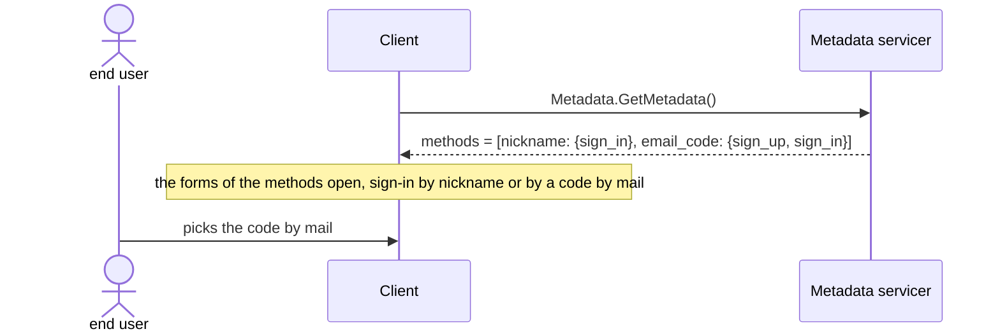

# ingot-auth: the auth

- Status: Draft; each story has its own
- Packages: ingot-auth (core, the memory contribs, the gRPC contrib);
  ingot-grpcio is read, not changed
- Date: 2026-11-03
- ADRs: 0004 (slots), 0005 and 0010 (contracts), 0007 (layout), 0009 and
  0011 (gRPC contracts), 0012 (this process)

The design of the auth as a whole, by [ADR 0012](../../adr/0012-design-a-feature-before-building-it.md):
a file a part of the domain, this one the whole, the metadata and the
slices. It lives on: a story is accepted for its slice, and marked
implemented once built; the rest waits as drafts.

## How to read it

- **A story** is a row of a table, `# | Actor | Story | Needs | Status`: the
  story bold, then what it takes, the rules, the examples (given, when,
  then); `Needs` gives the stories it stands on, directly.
- **Its id** is the file and its number, `sessions.2.1`; the README of a
  directory is named by it, `auth.1.1`, `methods.4.1`. A link to a story of
  another file names the whole id, one within the file the number.
- **Its status**: `Draft`, written, not taken; `Accepted`, taken for the next
  slice; `Implemented`, in the code of `main`.
- **A question** is in the file it is of, naming the stories it holds:
  those of the next slice are listed below, the others parked till their
  slice comes.
- **Floods are out of scope**: a cloud or a balancer in front takes them
  (the user, 2026-11-04), an application of ingot-auth hardly facing the
  internet on its own. The threats are those of the logic: guessing,
  enumeration, takeover; a denial of service only where the design itself
  piles things up, the sessions, the reads of the storage.
- **A variation of behaviour** is a strategy or a policy, never a flag or a
  hook of its own: a strategy decides how something goes (the lifetime of a
  session, what happens over the limit), a policy accepts or refuses a value
  (the length of a password, as in `ingot_auth.policies`). Either is an
  entity in a slot, the core giving the usual ones, an application picking
  one or writing its own. No slot has a default: the explicit over the
  implicit, a little more work at the start for more understanding and
  control (the user, 2026-11-03). A starter ([1.3](#auth-1-3)) takes the
  work off.

## The parts

| File | What |
|---|---|
| [methods/](methods/README.md) | How a user proves who it is: the identifiers and the credentials, the methods, their protocols (sign-up, sign-in, bind) and toggles, the password they share, the second factors, a file each |
| [sessions.md](sessions.md) | What a sign-in opens: the token, the attributes, the work in a session, the lifetime and the limit |
| [sign-out.md](sign-out.md) | How a session ends by a user or an operator, and a block |
| [access.md](access.md) | What a caller may do: the permissions, the users and the groups |
| [profile.md](profile.md) | What the auth knows of a user: the tags, the attributes, the permissions, and the profile a client sees |

## The concept

Three questions, asked in turn on the way of a request:

- **Who are you? The identification.** A user is a profile, its `uid` what
  the rest of an application knows it by. A profile is found by an
  identifier bound to it: a nickname, an email, a phone, the id of a
  provider. A profile binds as many as it likes, and each opens the methods
  of its kind: an email bound, the sign-in by it with the password, or by a
  code sent to it.
- **Prove it. The authentication.** A method verifies the identifier by a
  credential ([methods](methods/README.md)): the password of the profile at
  once, a code by mail in two, a second factor after the password if the
  profile has one. Signing up binds the identifier to a new profile,
  signing in opens a session for the profile it is bound to, binding adds
  it to the profile of the caller. Then the token of the session stands for the proof on every
  request ([sessions](sessions.md)), till the session ends
  ([sign-out](sign-out.md)).
- **May you? The authorization.** The token gives a caller of ingots, its
  uid and permissions ([access](access.md)); an operation declares the
  permissions it requires and the checker of ingots compares. The client
  gets the same permissions, with the tags and the attributes of the
  profile ([profile](profile.md)), to build its interface.

## Actors

- **The end user**: signs up and in, stays signed in, signs out, sees the
  devices signed in and signs one out.
- **The developer of a client**: learns from the metadata what it can sign
  up and in by, runs the steps of a method, keeps the token, sends it with
  each call, tells "sign in again" from other errors.
- **The author of an application**: picks a starter, or the methods, the
  lifetime of the sessions and their limit, decides what a signed-in caller
  may do.
- **The author of a method**: writes its steps once, for the sign-up, the
  sign-in and the bind.
- **The author of a transport** (the gRPC contrib, an HTTP one later): reads
  the token of a request, turns it into a caller, gives the attributes of
  the transport (the IP).
- **The author of an operation** of the application: needs the uid of the
  caller, and nothing else of the auth.
- **The operator**: signs out every session of a profile, blocks a profile,
  clears the expired sessions, sees when and where a profile signed in.

## Domain

- Events: `SignedUp`, `SignInStarted`, `SignInRefused`, `SignedIn` (a
  session opened), `SessionSeen`, `SignedOut`, `SessionRevoked`,
  `SessionEvicted`, `SessionExpired`, `ProfileBlocked`.
- Commands and who gives them:
  - read the metadata, the methods among it: the client, before anything;
  - start and answer a sign-up, a sign-in, a bind: the client, for the end
    user;
  - authenticate a token: the transport, on every request;
  - sign out: the client, with the token of its session;
  - list the own sessions, revoke one of them, revoke all the others: the
    client, for the end user;
  - revoke the sessions of any profile, block a profile: the operator;
  - sweep the expired sessions: the operator, or a schedule.

The states of a session are in [sessions](sessions.md#domain), those of an
attempt in [methods](methods/README.md#domain).

## Stories

### 1. The metadata and the starters

What a client and an application see and pick before anything.

| # | Actor | Story | Needs | Status |
|---|---|---|---|---|
| <a id="auth-1-1"></a>1.1 | client | **I load the metadata of the auth to learn which methods I can sign up and sign in by, so that I show the user those and no others.**<br>• The metadata of the profiles and of the sessions is there, their registries, and that of the methods with them.<br>• The metadata lists the methods in the slots of the methods of the application, whatever they are: a method of the core or one of the application's own, each by its name, the path of its slot, with the flows open by it ([methods.1.2](methods/README.md#methods-1-2)). It knows no method of the core by itself: they are a catalogue, bound by the application ([methods.1.1](methods/README.md#methods-1-1)) (the user, 2026-11-04).<br>• A method opens the flows it takes by its hooks, `_get_sign_up_enabled`, `_get_sign_in_enabled`, closed in the base: a flow it does not take is listed closed, the client needs no more (the user, 2026-11-05).<br>• Example: given the nickname method bound with its sign-up closed, and the `email_code` one not bound, a client reads `[{name: nickname, sign_up: false, sign_in: true}]`: the nickname is there, its sign-up closed for now.<br>• The client calls a method by its own typed service (`Nickname.SignIn`): the list tells only which are there. | [methods.1.1](methods/README.md#methods-1-1) | Implemented |
| <a id="auth-1-2"></a>1.2 | client | **The metadata gives the policies a method checks, the length of a password, so that I check a form before sending it.** | [1.1](#auth-1-1) | Draft |
| <a id="auth-1-3"></a>1.3 | application | **I import one starter that suits me, `game` or `web`, instead of a dozen classes to pick and subclass, and override only what differs.**<br>• `contrib/starters/`, a flat list, each units an application inherits and overrides, picking the methods and the strategies, or the storage, the cache and the transport too, under an extra of its own when it needs libraries; not "presets", which ingot-auth has twice already.<br>• Its worth grows with all that is bound by hand (the user, 2026-11-04): the methods, the configs of each, their servicers, the strategies of the sessions, of the timing, of the second factor. A starter binds them once, as they go together, and the creation of the project checks it as any application.<br>• Example: given `class AppAuth(AuthWebStarter)`, the application has the sign-up by `email_code`, the sign-in by `nickname` and `email_code`, a sliding month, the oldest session evicted, overriding only the slot of the mail. | [access.1.1](access.md#access-1-1), [sessions.3.1](sessions.md#sessions-3-1), [sessions.3.3](sessions.md#sessions-3-3) | Draft |

## Flows

The metadata, before any sign-in: what the client shows.



## API sketch

The client (story [1.1](#auth-1-1)), in Python for the sketch:

```python
metadata = await auth.GetMetadata(GetMetadataRequest())
methods = {method.name: method for method in metadata.methods}
if "nickname" in methods and methods["nickname"].sign_in:
    ...  # show the form of the nickname and the password
```

The metadata of the methods, a list of those bound:

```proto
// ingot_auth/metadata/v1/metadata.proto
// whether each flow is open, closed as well when the method does not take
// it; bind comes with the bind
message Method {
  string name = 1;  // the path of its slot: nickname, email_code
  bool sign_up = 2;
  bool sign_in = 3;
}

message GetMetadataResponse {
  Profile profile = 1;
  Session session = 2;
  repeated Method methods = 3;
}
```

In the core, `ingot_auth/metadata/`: a part `methods` of `AuthMetadata`,
a tuple of `AuthMethodMetadata(name, flows)`, one a slot of the methods,
found by `slots_find_entities` of `BaseAuthMethod`.

The packages of the core, a flow a package, as `sign_up/` is (the user,
2026-11-05):

- `ingot_auth/sign_in/`: the sign-in ([methods](methods/README.md#api-sketch));
- `ingot_auth/sign_out/`: the sign-out, likely one operation,
  `op_sign_out` ([sign-out](sign-out.md#api-sketch));
- `ingot_auth/sessions/`: the sessions, their registries, their lifetime,
  their revokes, all in the unit `AuthSessions`, no package within (the
  user, 2026-11-05) ([sessions](sessions.md#api-sketch)).

A starter (story [1.3](#auth-1-3)), the strategies picked once for a kind of
application:

```python
class AppAuth(AuthWebStarter):  # email sign-up, sliding month, evict the oldest
    methods = Slot(AppMethods)  # the email_code method with the mail of the app
```

## Pre-mortem

Six months on, the auth failed. Why:

- Every request went to the storage: the touch, the miss of the cache. The
  touch is written once per interval, the cache holds the open sessions
  ([sessions](sessions.md)).
- A revoked token still worked: the cache was not cleared, or another
  process had its own memory cache. Forgetting follows each close; the memory
  cache is for one process only, said in its docs, Redis for more.
- The strategy of the permissions was too narrow. It takes the uid and
  returns `Permissions`, of the groups of the user; if it needs the
  session, it takes the record instead ([access](access.md)).
- A grant to a group made the sessions of its members stale: the
  permissions are of the caller, kept apart from the session, so a change
  forgets the callers only ([access Q8](access.md#access-q8)).
- An application tuned the configs of one strategy and bound another: the
  sessions lived as long as the defaults of the other. The docstring of each
  strategy names its configs; the rest is the care of the application.
- `AuthCaller` did not fit ingots: an operation of another addon cannot see
  the session. Only the operations of the sessions read `session_id`; the rest
  read the uid.
- Applications wanted stateless tokens for their other services. Story
  [sessions.3.6](sessions.md#sessions-3-6): an operation that checks a token,
  before any JWT.
- The sign-in of two factors did not fit the steps of a method. The flow
  owns the steps (story [factors.1.1](methods/factors.md#factors-1-1)), so a
  second factor is a next step of the flow, whatever the method.

## Questions

Of this file: none now.

Those the next slice, 2, needs answered: none now.

## Slices

The implementation, a pull request a slice, each with its first consumer, in
the order of `Needs`: a slice takes no story before those it needs.

1. The methods move from `contrib/methods/` to `methods/`
   ([methods.1.1](methods/README.md#methods-1-1)). No story of its own: a
   move.
2. **A thin path**: [auth.1.1](#auth-1-1);
   [methods.1.1](methods/README.md#methods-1-1),
   [1.2](methods/README.md#methods-1-2), [1.3](methods/README.md#methods-1-3),
   [2.2](methods/README.md#methods-2-2), [2.4](methods/README.md#methods-2-4),
   [4.1](methods/README.md#methods-4-1), [4.2](methods/README.md#methods-4-2);
   [password.1.2](methods/password.md#password-1-2),
   [2.1](methods/password.md#password-2-1);
   [nickname.2.1](methods/nickname.md#nickname-2-1);
   [access.1.1](access.md#access-1-1),
   [2.1](access.md#access-2-1)–[2.5](access.md#access-2-5);
   [sessions.1.2](sessions.md#sessions-1-2),
   [2.1](sessions.md#sessions-2-1)–[2.4](sessions.md#sessions-2-4), and
   [3.1](sessions.md#sessions-3-1) with the fixed strategy only. The methods
   and their toggles in the metadata, the groups, their grants and members,
   the identities by identifier and the
   password of the profile, a sign-in by nickname, a session in the memory
   storage and cache, `authenticate()`, the gRPC `Nickname.SignIn` and
   `SignIn.AnswerSignIn`, an asynchronous `_get_caller`; a test signs up, signs
   in, calls an operation as the user.
3. [sessions.3.1](sessions.md#sessions-3-1) the sliding strategies, the
   touch, the lazy close; [sessions.1.3](sessions.md#sessions-1-3); the
   sign-in by a code by mail, [email-code.2.1](methods/email-code.md#email-code-2-1),
   its code sent in the background, [methods.2.3](methods/README.md#methods-2-3).
4. [sign-out.1.1](sign-out.md#sign-out-1-1),
   [sessions.3.2](sessions.md#sessions-3-2),
   [sign-out.1.2](sign-out.md#sign-out-1-2),
   [sessions.3.5](sessions.md#sessions-3-5),
   [profile.1.2](profile.md#profile-1-2),
   [profile.1.3](profile.md#profile-1-3): sign-out, the own sessions listed
   and revoked, the record of the sign-ins, the values of a profile, the
   profile of the caller and its hash; their gRPC services.
5. [sign-out.1.3](sign-out.md#sign-out-1-3),
   [sessions.3.4](sessions.md#sessions-3-4): the operator signs out a
   profile, sweeps, by the CLI.
6. [sessions.3.3](sessions.md#sessions-3-3): the limit of the sessions.
7. [auth.1.3](#auth-1-3): the first starter, `web`, out of what the slices
   above built; the tests of the slices then bind it.
8. The MongoDB backends of the sessions, with the profiles and identities
   still waiting for theirs. No story of its own: the stories above on
   another backend.

Later, each in a slice of its own once its needs are built:
[auth.1.2](#auth-1-2);
[methods.2.5](methods/README.md#methods-2-5),
[3.2](methods/README.md#methods-3-2),
[4.3](methods/README.md#methods-4-3),
[5.1](methods/README.md#methods-5-1),
[5.2](methods/README.md#methods-5-2);
[password.1.3](methods/password.md#password-1-3)–[1.5](methods/password.md#password-1-5),
[2.2](methods/password.md#password-2-2), [2.3](methods/password.md#password-2-3);
[nickname.3.1](methods/nickname.md#nickname-3-1);
[email.1.1](methods/email.md#email-1-1), [2.1](methods/email.md#email-2-1),
[3.1](methods/email.md#email-3-1);
[email-code.2.2](methods/email-code.md#email-code-2-2),
[3.1](methods/email-code.md#email-code-3-1);
[factors.1.1](methods/factors.md#factors-1-1)–[1.3](methods/factors.md#factors-1-3);
[access.1.2](access.md#access-1-2), [3.1](access.md#access-3-1);
[sessions.3.6](sessions.md#sessions-3-6),
[3.7](sessions.md#sessions-3-7);
[sign-out.1.4](sign-out.md#sign-out-1-4).

## The first prototypes

Written on 2026-10-27 before the addon was built; kept as a snapshot, not
maintained. Older than ADR 0012: no stories, only the code.

- [facade](facade/): the logic of auth from sign-up to the authenticated
  request over a facade of the storage, with its contract tests and a memory
  backend. It hardcodes a password hashed by scrypt, against the goal of a
  core that assumes no method: the addon keeps its methods pluggable.
- [profile](profile/): the schema of the profile joined from addons and an
  application, `AuthAttributes` made dataclasses and mapped one to one onto
  the flat values a storage keeps.
