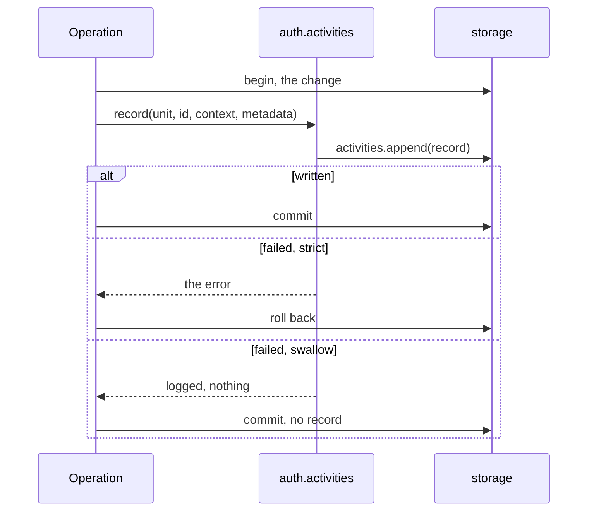

# ingot-auth: the activity log

A part of [the design of the auth](README.md), by
[ADR 0015](../../adr/0015-keep-an-activity-log-in-each-addon.md). Who changed
what and when: a record a change of the state of an entity of the auth,
written with the change, read by the auditors. The entities keep their state
alone, not who changed it (the user, 2026-11-15).

## The concept

- **A record** tells one change of state. Its actor, two parts of one
  whole: `who`, the uid of the caller, `root` for the command line,
  `auth.system` for what the server does by itself, a session expiring;
  and `session_uid`, of the session of the caller, where its device and
  its place are, none of a caller of none, a part of the actor, not of
  the change, so that `record()` fills it and a stolen session is found
  by it (the user, 2026-11-15). Then `action`, what was done, of
  `AuthActivityAction`; `entity_type`, the full name of the unit of the
  entity, `auth.profiles`, `auth.sessions`, never written by hand;
  `entity_uid`, its uid, of a session or of an item of a registry, as a
  string; `context`, what the change was, optional; `run_uid`, the uid
  of the run of operations it belongs to, not of one operation: the id
  of the request the client sent, or one a job of the server generated,
  in the background or by a schedule, a sweep, every record of the run
  sharing it, always there: the server closing a session by itself in
  `authenticate()` takes a new one, which its line in the log tells, to
  link them (the user, 2026-11-15); `when`.
- **An action** is create, update, delete of an entity, or another verb of
  the domain where it tells more: `bind` and `unbind` of an entity linking
  others, a member to a group, an attribute to a preset; `sign_in`,
  `sign_out`, `revoke`. A read is never recorded, nor a refusal: the log
  keeps changes of state alone (the user, 2026-11-15); a refused sign-in is
  for the logger and the limits.
- **The context is optional, a dataclass an activity of a type of entity**,
  typed where an operation writes it, in the code of its time: the creation
  of a tag needs none, that of an attribute a little, its name and type, the
  values of the attributes set for a user more (the user, 2026-11-15). It is
  the set of the possible attributes of the type of entity that the code of
  the time writes; mypy checks what an operation gives, no registry of fields
  to manage. The storage keeps it as a map of attributes and gives it back as
  one, a fact as it was written, never migrated: a reader, an administration
  to come, assumes no attribute of a type of entity, and shows the set each
  record has, the old ones as they were, the new ones after a change of the
  code as they are.
- **Written in the transaction of the change**: what a failure to write it
  does is a strategy in the slot `failure` of the log, which the application
  declares, as the sessions have no lifetime of their own:
  `AuthStrictActivityFailure` fails the change with it,
  `AuthSwallowActivityFailure` logs the failure and lets the change through
  (the user, 2026-11-15).
- **Read by the auditors**, `auth.activities.grp_auditors`, by the flag
  `CAN_READ` of `auth.activities`, filtered by who, action, entity and time,
  the newest first.

## Stories

### 1. The log

| # | Actor | Story | Needs | Status | Coverage |
|---|---|---|---|---|---|
| <a id="activity-1-1"></a>1.1 | application | **I declare what a failure to write the log does: it fails the change, or it is logged and the change goes through.**<br>• The strategy in the slot `failure` of `auth.activities`, `BaseAuthActivityFailure`: `AuthStrictActivityFailure` raises the error of the storage, the transaction of the change rolled back; `AuthSwallowActivityFailure` logs it at the level `ERROR`, with the record, and returns.<br>• No default: the application picks one, as it picks the lifetime of the sessions; the memory of `python -m ingot_auth` is strict. | — | Implemented | unit |
| <a id="activity-1-2"></a>1.2 | author of an addon | **I record the change my operation makes, its action, with a context if it needs one, in its transaction, and mypy refuses what is not one.**<br>• `await self.project.auth.activities.record(self.parent, entity_id, AuthActivityAction.CREATE, metadata)`, a context the last, `context=AuthAttrCreated(name=..., type=...)`: the unit gives the type of the entity, its full name; the metadata the caller, its session and the run, always given: the server acting by itself gives that of its caller `auth.system`, `operations.create_metadata(operations.callers.get_auth_system())`, a new run.<br>• A context extends `AuthActivityContext`, a dataclass, one an activity of a type of entity that needs one; its fields are what the change was, never a secret, a token, a password, a code.<br>• The record is written in the transaction the operation has open, or on its own if none is. | 1.1 | Implemented | unit |
| <a id="activity-1-3"></a>1.3 | operator | **I read the activities, of an entity, of a caller, of an action, in a span of time, the newest first.**<br>• `auth.activities.op_list`, `AuthListActivitiesParameters`, each filter optional, `limit` 100 by default; on the command line `auth activities list --entity auth.profiles:0f6c… --who … --action … --since … --until … --limit …`, over gRPC `ListActivities` of the service `Activities` of `ingot_auth.activities.v1`.<br>• The flag `CAN_READ` of `auth.activities`, granted by `auth.activities.grp_auditors`, a group of the core holding none but it.<br>• The history of a profile ([profile.2.1](profile.md#profile-2-1)) is this, filtered by the profile. | 1.2 | Implemented | `test_operator` |

### 2. What the core records

| # | Actor | Story | Needs | Status | Coverage |
|---|---|---|---|---|---|
| <a id="activity-2-1"></a>2.1 | operator | **I find every change of state of the auth in the log, by its action.**<br>• The profiles, `auth.profiles`: `create` by a sign-up, its method and identifier kind in the context; `update` by the values set, the ids of the tags, the values of the attributes by their ids. The identities, `auth.profiles`: `bind`, the kind, never the value. The password: `set`, nothing of it.<br>• The sessions, `auth.sessions`: `sign_in`, the method; `sign_out`; `revoke`, the caller of another session of its own; `expire`, the reason, by `auth.system` ([Q1](#activity-q1)), or by the caller of a sweep.<br>• The registries, their full names: `create`, `rename`, `delete` of the tags, no context, of the attributes of the profiles and of the sessions, the name and the type, the source too, of the presets; `bind` and `unbind` of an attribute to a preset, with its requirement.<br>• The members, `auth.access.members`: `bind` and `unbind` of a profile to a group, the group in the context. | 1.2 | Implemented | `test_operator` |
| <a id="activity-2-2"></a>2.2 | application | **A session keeps its state, not who closed it: the log tells who.**<br>• `closed_by` of `AuthSessionRecord` goes, with its field in the storages; the record of the sign-ins ([sessions.3.5](sessions.md#sessions-3-5)) tells when and why from the session, who from the log, by the id of the session.<br>• A minor version, 0.4.0: a storage drops the field, the log of 0.4.0 holds no record of what 0.3.0 closed. | 2.1 | Implemented | unit |

Built by ingot-auth#60, the log and the registries, #61, the records of
the core, the flows taking their metadata to their end, and #62, `closed_by`
gone. The keys of a context are texts in the log, so that a map by ids, the
values of a profile, keeps in any storage; a sign-up and a sign-in are of
the anonymous caller, the profile in the entity or the context.

Later, each once one asks: how long the log is kept and its sweep, with the
closed sessions and the records of the sign-ups
([profile.3.4](profile.md#profile-3-4)); a part of the log a user sees of
its own profile, a server's facts of the code (the user, 2026-11-15: maybe).

## Flows

A change and its record, in one transaction:



## API sketch

An operation of the core, or of an addon of the auth, records its change:

```python
@dataclass(frozen=True, slots=True, kw_only=True)
class AuthProfileTagsSet(AuthActivityContext):
    tag_ids: tuple[int, ...]


class AuthSetProfileTagsOperation(BaseOperation[...]):
    async def _run(self, parameters, metadata):
        ...
        await storage.values.set_tags(parameters.uid, parameters.tag_ids)
        await self.project.auth.activities.record(
            self.parent,
            parameters.uid,
            AuthActivityAction.UPDATE,
            metadata,
            context=AuthProfileTagsSet(tag_ids=...),
        )


class AuthCreateTagOperation(BaseOperation[...]):
    async def _run(self, parameters, metadata):
        ...
        await self.project.auth.activities.record(
            self.parent, str(tag.id), AuthActivityAction.CREATE, metadata
        )  # no context
```

The application picks the strategy:

```python
class AppActivitiesUnit(AuthActivitiesUnit):
    failure = Slot(AuthStrictActivityFailure)
```

The operator reads:

```console
$ python -m app auth activities list --entity auth.profiles:0f6c… --limit 20
2026-11-15T12:00:00+00:00	root	update	auth.profiles	0f6c…	tag_ids=[1, 3]
```

The prototype [activity](activity/) runs it: a change and its record,
strict and swallowed, the read of the auditors.

## Threats

| Category | Threat | Answer |
|---|---|---|
| Repudiation | A change made with no trace. | The record written in the transaction of the change; under `strict` none goes without it. |
| Information disclosure | The log keeps a secret, a token, a code. | A context is a dataclass reviewed with its operation, its fields never a secret; the value of an identifier stays out, its kind in. |
| Information disclosure | A user reads the log of others. | The flag `CAN_READ` of the auditors alone. |
| Tampering | A record changed or deleted. | The log has no operation but append and read; the storage is the trust boundary. |
| Denial of service | The log grows without end. | Its sweep, later ([profile.3.4](profile.md#profile-3-4)). |

## Questions

1. <a id="activity-q1"></a>Answered: a session expiring is closed by the
   server, `who` the actor of the code, `system`, its run a new one, told
   by the line of the log of the server: it is not the initiative of a
   user, nor of an operator (the user, 2026-11-15). Named `auth.system`
   since slice 6, of the domain of the auth (the user, 2026-11-16).
