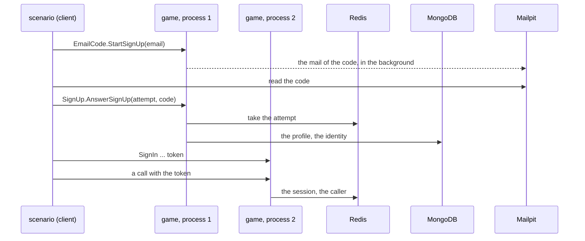

# The game: the backend of a metagame with the auth

- Status: Proposed
- Packages: ingot-auth (`examples/game/`); ingot-grpcio, ingot-pymongo,
  ingot-redis, ingot-mail as its extras take them
- Date: 2026-11-17
- ADRs: [0016](../../../adr/0016-run-the-addons-in-examples.md),
  [0012](../../../adr/0012-design-a-feature-before-building-it.md)

## Problem

The addons are proven alone; none runs in an application. The first
example of ADR 0016, in the repository of ingot-auth, is the backend of
the metagame of a game, the accounts of its players, which a client of a
game engine calls by gRPC: the application composes the auth with its
transport, its storage, its cache and its mail, and runs as it would run
in production, two processes behind one address, configured by the
environment. The metagame itself, the profiles of the players, their
wallets, the leaderboards, comes later: the first version is the auth
alone, to see the integration from an application.

## Actors

- The player, through the client of the game: signs up, signs in, calls
  with the token. A client of Python in the scenarios; no client of an
  engine is written.
- The operator: grants a group to a player on the command line of the
  application.
- The author of the application: composes the project of the addons.
- The CI of ingot-auth: runs the scenarios against the application in
  Docker, on each pull request and as a dependent of the infrastructure.

## Stories

| # | Actor | Story | Now or later |
|---|---|---|---|
| 1 | author of the application | I compose `AppProject` of `AuthProject`, `GrpcProject`, `MongoDbProject`, `RedisProject`, its mail by SMTP, its methods the nickname and the email code, and run it by `python -m app components run-forever --component grpc.servers.default`. | now |
| 2 | author of the application | I configure it by the environment alone, `APP_*`, the servers by their hosts, the secrets apart. | now |
| 3 | player | I sign up and sign in by a nickname and a password, and call with the token. | now |
| 4 | player | I sign up by my email and the code sent to it, read from Mailpit by the scenario. | now |
| 5 | player | I sign out, and my token is refused. | now |
| 6 | operator | I add a player to a group on the command line, `python -m app auth access members add`, and the player has its permission on its next call, without signing in again. | now |
| 7 | player | My session opened on one process is known to the other, by the cache in Redis. | now |
| 8 | player | A guest by its device, an email bound later; the profile, the wallet, the leaderboards of the metagame. | later |
| 9 | author of ingot-auth | At the cut of a release I run the load on the dev server, the candidate against the release before it, one after the other on the same machine: the call with a token, the sign-in by its throughput, the floor of its timing off, the sign-up; p50, p95 and the calls a second of each go into the pull request of the release. Not on the runners of GitHub. The host quiet: the IDE connected to it off, the boost of the CPU off, the application, the servers and the load each on cores of their own, no swap-in during the run; the run refuses to start otherwise, and a run that swapped is void. Each run appends to `examples/game/perf/results.csv` of ingot-auth, a metric a row, in the pull request of the release: the date, the run, the version, its role, candidate or baseline, its commit, the Python and the servers as they ran, the host with its state, the scenario, the clients, the metric and its value; the two of a run compare on any host, the runs over time on the same host alone. | later |

## Coverage of the auth

The scenarios run the stories of the auth its players, its operator and
its client meet, those built. The stories themselves tell it: the column
`Coverage` of the tables of [the auth](../README.md) names the
scenario of each, `test_sessions`, and the slice of the game bringing it
while it is to come; a story of the composition, the transport or an
author is proved by the unit tests and the contracts, `unit`.

## Flows



## API sketch

No prototype of stubs: the example is the code of its consumer, built
against ingot-auth of the same commit. Its layout in ingot-auth:

```
examples/game/
  app/                # AppProject, its units, __main__, as the guides name them
  scenarios/          # unittest cases of the client, their steps
  Dockerfile          # the wheel of dist/, its extras, game/
  docker-compose.yml  # app twice, cli, MongoDB, Redis, Mailpit
```

No `pyproject.toml` of its own: the example runs in the environment of
ingot-auth. Its stack is the extra `game` of ingot-auth, the first half of
a starter ([auth.1.3](../README.md#auth-1-3)):

```toml
game = ["ingot-auth[grpcio,pymongo,redis]", "ingot-mail[aiosmtplib]"]
```

The dev group takes it, the image installs `dist/*.whl[game]`, as the
application of a user installs `ingot-auth[game]`.

The operator runs its commands in the service `cli` of
`docker-compose.yml`, the image of the application idle,
`docker compose exec cli python -m app auth ...`, and a step of the
scenarios does the same. The Makefile of ingot-auth gains `example-test`: `make all`, the
image, `docker compose up`, the scenarios, `down`; `lint` takes
`examples/`. The image installs the versions of `uv.lock`, by
`uv export`, as the application of a user installs its own lock.

The project, as the guides of the addons tell it:

```python
class AppProject(AuthProject, GrpcProject, MongoDbProject, RedisProject):
    settings = Slot(AppSettingsUnit)  # the configs of the five joined
    logging = Slot(AppLoggingUnit)
    mail = Slot(AppMailUnit)          # AiosmtplibMailer
    grpc = Slot(AppGrpcUnit)          # the bindings of the player
    auth = Slot(AppAuthUnit)          # MongoDB, Redis, the two methods
```

A scenario, its steps plain functions and mixins:

```python
class SignUpByEmailScenario(GameMixin, unittest.IsolatedAsyncioTestCase):
    async def test_a_player_signs_up_by_the_code_of_its_email(self) -> None:
        email = new_email()
        attempt = await self.game.start_sign_up_by_email(email)
        code = await self.mailpit.read_code(email)
        signed_up = await self.game.answer_sign_up(attempt, code)
        ...
```

## Open questions

- The two processes behind one address: a proxy of gRPC in
  `docker-compose.yml`, or the scenario calling each by its port.

## Slices

1. The skeleton: the extra `game`, `examples/game/` with the project,
   Docker, the first scenario, story 3, `make example-test` and its CI
   job; the ruleset of ingot-auth requiring it, by a script for the user.
2. Stories 4 and 5: the mail by Mailpit, the sign-out.
3. The rest of the player: the sessions of the player by
   `AuthGrpcSessionsBinding`, the metadata, the profile and its hash,
   what a sign-up and a sign-in refuse. Built: ingot-auth#78.
4. Stories 6 and 7: the operator and the auditor on the command line,
   the second process, `test_operator` and `test_processes`. The
   scenarios are a project of their own since ingot-auth#80, run by
   `testing run` ([testing](../../testing/README.md), its slice 2).
   Built: ingot-auth#81.
5. The starter, [auth.1.3](../README.md#auth-1-3): what the composition
   of the example shares with any game moves to
   `ingot_auth.contrib.starters.game`, importable with the extra `game`;
   the example keeps its own, a subclass of the starter and its configs.
   The second half of the starter, its first consumer the example.

With slice 7 of the auth, the limit of the sessions,
[sessions.3.3](../sessions.md#sessions-3-3), the game evicts the session
seen longest ago, `APP_AUTH_SESSIONS_MAX=3` in its compose, a scenario of
`test_sessions` evicting by the fourth sign-in. Three, not the one session
a player of a real game keeps: the sets of sessions of a player, listed and
revoked, have no other application to be tested by yet (the user,
2026-11-18). Once a web example comes, the game keeps one and those
scenarios move to the web.
