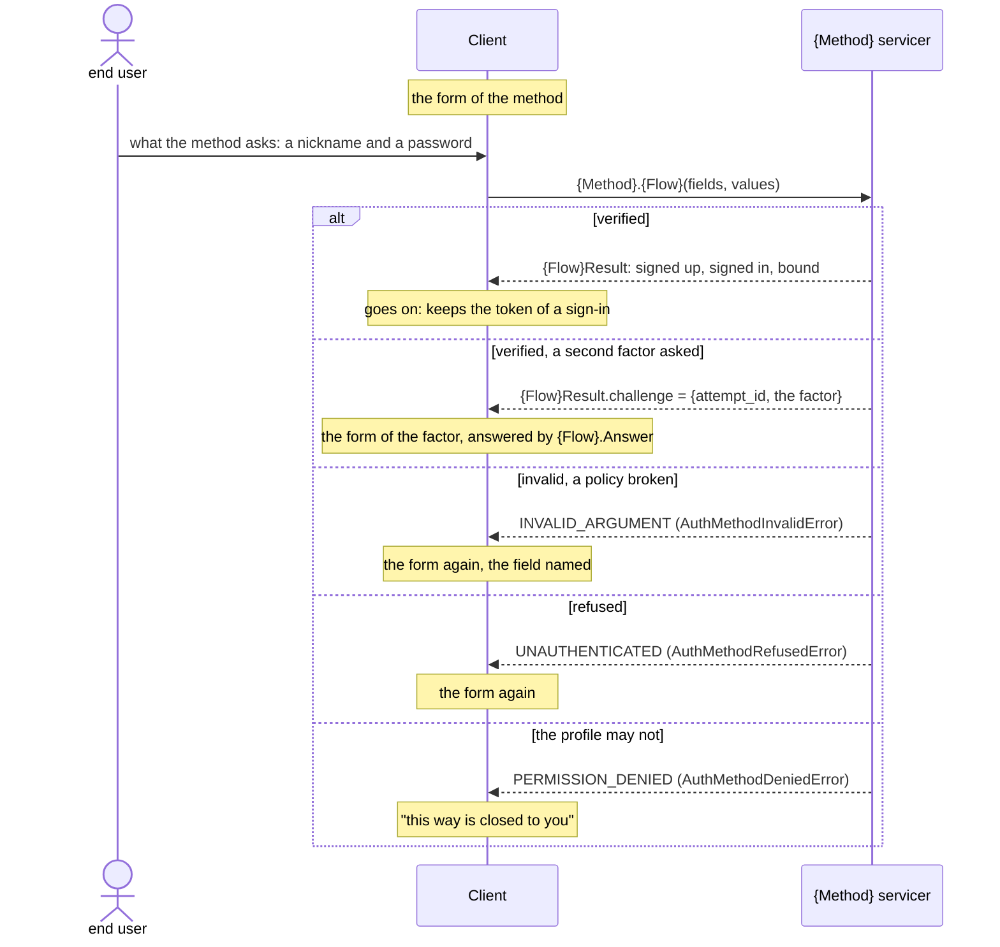
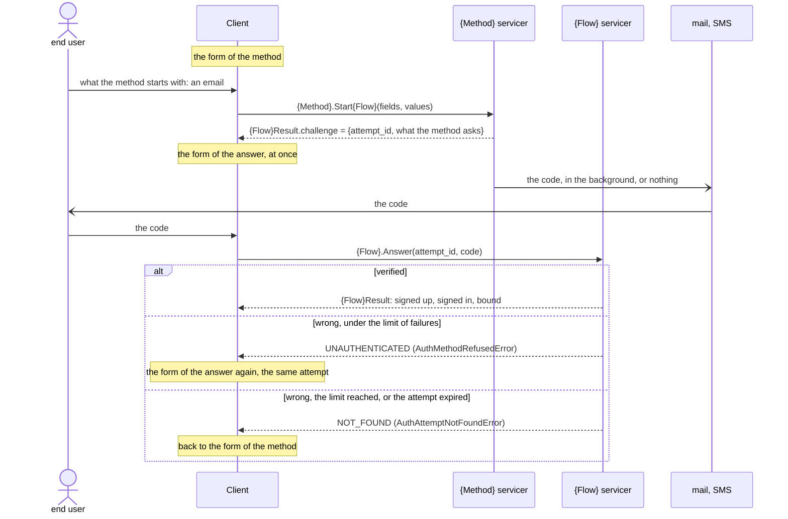
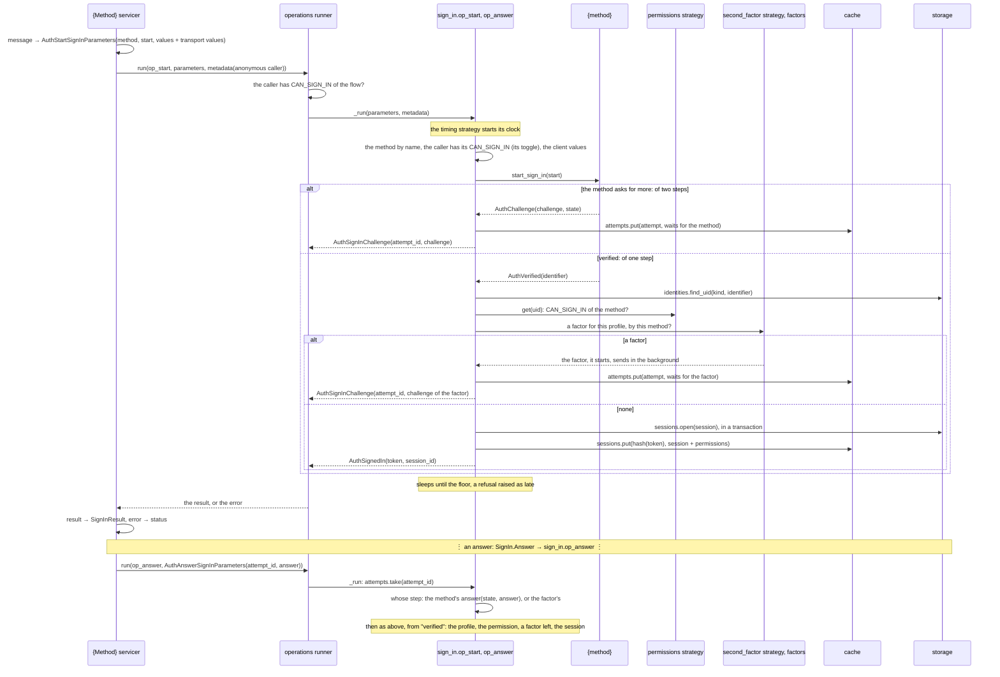
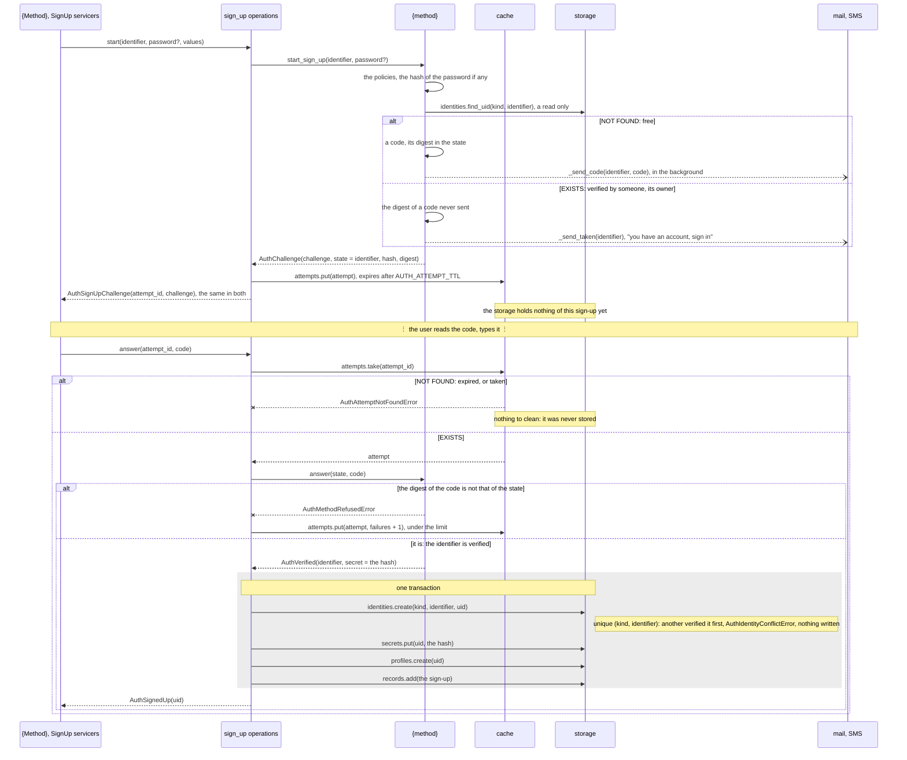

# ingot-auth: the methods

A part of [the design of the auth](../README.md): how a user proves who it
is. A file a method, [nickname](nickname.md), [email](email.md),
[email_code](email-code.md); the [password](password.md) the methods of
one step share; the [factors](factors.md), a second step of the flow.

## The concept

- **An identifier** names a profile: a nickname, an email, a phone, an id
  at a provider. It is bound to one profile, unique by its kind; a profile
  binds as many as it likes, by a sign-up first, by a bind later
  ([5.1](#methods-5-1)).
- **A credential** proves it: the password of the profile, a code sent to
  the email or the phone, the token of a provider.
- **A method** is an identifier with a credential:
  - `nickname`, `email`, `phone`: the identifier and the password, in one
    step; they share the password of the profile, so that a user signed up
    by nickname who binds an email signs in by either with the same
    password ([password](password.md));
  - `email_code`, `phone_code`: the identifier and a code sent to it, in two
    steps, the second built in;
  - `apple`, `google`: the token of the provider, in one step.
- **A verification** proves that an identifier is the user's, once, before
  it is bound: an email or a phone by a code sent to it; a nickname needs
  none, it is only to be free; the id of a provider comes verified by its
  token. Not a credential: it says whose the identifier is, not who signs
  in ([2.5](#methods-2-5)).
- **A factor** is a second credential the flow asks for after a method of
  one step: a code by mail, a code by SMS, a code of an authenticator app
  ([factors](factors.md)). A method of a code has its second step built in
  and takes none. An identifier bound opens its methods and its factors: an
  email bound, the sign-in by `email` and by `email_code`, and the code by
  mail as a second factor.

A method verifies in steps, and knows nothing of what comes before and
after them, the attempt, the profile, the factor, the session: those are of
the flow it runs in. The flows are three, the protocols every method takes
part in, or refuses:

- **SignUp**: the identifier verified is bound to a new profile.
- **SignIn**: the profile the identifier is bound to gets a session.
- **Bind**: the identifier verified is bound to the profile of the caller.

The number of steps is not a protocol: any start may end with a challenge,
of the method or of a factor, so a method of one step is a method of two
whose second step was not needed. A method has typed starts, a flow one
answer for all ([2.2](#methods-2-2)).

The methods live in the core, `ingot_auth/methods/<method>/`, a catalogue,
as the policies are: none is bound anywhere until an application or a
starter declares its slot, and its configs with it ([1.1](#methods-1-1));
the contribs give only what is infrastructure, the
storages, the caches, the transports, and the starters (the user,
2026-11-03). Today they are under `contrib/methods/`, `nickname` named
`password` and `email_code` named `email`: the move and the renames are
the first slice.

## The methods

What the core has and will have, by protocol: `Implemented`, in `main`;
`Not Implemented`, designed or not; `—`, the method takes no part in it.

| Method | Identifier | Credential | Steps | SignUp | SignIn | Bind |
|---|---|---|---|---|---|---|
| [nickname](nickname.md) | nickname | password | 1 | [Implemented](nickname.md#nickname-1-1) | [Not Implemented](nickname.md#nickname-2-1) | [Not Implemented](nickname.md#nickname-3-1) |
| [email](email.md) | email | password | 1 | [Not Implemented](email.md#email-1-1) | [Not Implemented](email.md#email-2-1) | [Not Implemented](email.md#email-3-1) |
| phone | phone | password | 1 | Not Implemented | Not Implemented | Not Implemented |
| [email_code](email-code.md) | email | code by mail | 2 | [Implemented](email-code.md#email-code-1-1) | [Not Implemented](email-code.md#email-code-2-1) | [Not Implemented](email-code.md#email-code-3-1) |
| phone_code | phone | code by SMS | 2 | Not Implemented | Not Implemented | Not Implemented |
| apple, google | id at the provider | token of the provider | 1 | Not Implemented | Not Implemented | Not Implemented |
| guest | device | — | 1 | Not Implemented | Not Implemented | — |

The bind of an email or a phone is of two steps whatever method signs in by
it: the identifier is verified by its code first ([2.5](#methods-2-5)). A guest is what a user
binds to ([5.2](#methods-5-2)), not an identifier bound to another
profile. The rows with no file have none yet.

## Domain

The attempt keeps a flow between its steps: made on a challenge, taken by
an answer, kept again while the answers refused stay under
`AUTH_ATTEMPT_MAX_FAILURES`, gone when it expires, after
`AUTH_ATTEMPT_TTL`. Its `flow` is the protocol, `sign_up`, `sign_in` or
`bind`: an answer of another flow finds none. It keeps whose step it waits
for, of the method or of a factor, and the answer goes there.

## Stories

### 1. Turning a method on

| # | Actor | Story | Needs | Status |
|---|---|---|---|---|
| <a id="methods-1-1"></a>1.1 | application | **I take the methods I want from those of the core, or write my own, as slots of my methods, and bind the configs of each with it; the others are not there.**<br>• The methods of the core are a catalogue, as the policies are: none is bound anywhere, `AuthMethods` has no slots, the metadata knows none by itself ([auth.1.1](../README.md#auth-1-1)). An application, or a starter for it ([auth.1.3](../README.md#auth-1-3)), declares a slot a method, `nickname = Slot(AuthNicknameMethod)`, its name the path of the slot, and the slot of its servicer in the transport alike (the user, 2026-11-04).<br>• A method bound binds its configs too: its package gives a class of them, `AuthNicknameConfigs`, mixed into the configs of the application, so that no core holds the configs of every method (the user: "явно прибиндил метод, прибинди явно и его конфигурацию"). The creation of the project refuses a method whose configs are not mixed in.<br>• The core still assumes no method: what a method needs from outside stays behind a hook, the mail of the `email_code` method (`_send_code`), the client of a provider for OAuth, its implementation by a contrib under an extra, or by the application.<br>• A transport mirrors the core alone (ADR 0011), its servicer of a method `contrib/transports/grpcio/methods/nickname.py`; no contrib imports another.<br>• Today an application declares the slot of a method as here, the method under `contrib/methods/`, with no configs of its own yet. | — | Draft |
| <a id="methods-1-2"></a>1.2 | client | **The metadata tells me which flows of each method are open now, by the toggles of the environment, a method bound but closed listed too, so that I know it is there.**<br>• A method comes with a config a flow it takes, of the class of configs of its package ([1.1](#methods-1-1)), the flow first: `AUTH_SIGN_UP_NICKNAME_ENABLED`, `AUTH_SIGN_IN_NICKNAME_ENABLED`, `AUTH_BIND_NICKNAME_ENABLED` (the user, 2026-11-04). A toggle is a switch of an environment, not a variation of behaviour: a config, not a strategy.<br>• A toggle switches two things at once (the user, 2026-11-04): its flag in the metadata, so that the client shows the method closed; and the permission of the flow of the method for the callers, `CAN_SIGN_UP` and `CAN_SIGN_IN` of the domain of the method on the anonymous caller, `CAN_BIND` taken off the signed-in one ([1.3](#methods-1-3)). A client that ignores the metadata, or one broken into, gets the refusal of the runner, `OperationPermissionsError`, the caller lacking the permission, as for any operation it may not run; each transport answers it as it answers that refusal, gRPC by `PERMISSION_DENIED`, as `AuthGrpcErrors` does already (the user, 2026-11-04).<br>• A refusal of a toggle tells nothing of the subject: it is of the environment, the same for all ([4.2](#methods-4-2)).<br>• The flags `CAN_SIGN_UP`, `CAN_SIGN_IN` of the domains of the flows, on the anonymous caller, stay the switch of a whole flow, of every method.<br>• Example: given `AUTH_SIGN_UP_NICKNAME_ENABLED` off, a client reads `{name: nickname, flows: {sign_up: false, sign_in: true}}`, and a sign-up by nickname is refused, `OperationPermissionsError`.<br>• The bind toggle comes with the bind ([5.1](#methods-5-1)), not before it: no config with nothing reading it.<br>• A toggle is on by default (the user, 2026-11-04): the slot of a method is the explicit choice already, a toggle is to close a flow in an environment. | [1.1](#methods-1-1), [1.3](#methods-1-3), [auth.1.1](../README.md#auth-1-1) | Draft |
| <a id="methods-1-3"></a>1.3 | application | **The flows of each method are permissions, of the caller of the environment and of the profile, checked as any other.**<br>• A method comes with its permissions, a domain of its own, `auth.methods.nickname`, a flag a flow it takes: `CAN_SIGN_UP`, `CAN_SIGN_IN`, `CAN_BIND`, read from the method, `method.PERMISSIONS`, a ClassVar of its flags.<br>• The caller of the environment gets them from the toggles ([1.2](#methods-1-2)): the anonymous caller `CAN_SIGN_UP` and `CAN_SIGN_IN` of each method open, the signed-in one `CAN_BIND`. The profile gets `CAN_SIGN_IN` and `CAN_BIND` from the strategy of the permissions ([access.1.1](../access.md#access-1-1)), the one of the core by the same toggles, checked once the method found it: none for the sign-up, which is once and before any profile.<br>• The flow checks the flag of the method the parameters name, as the runner cannot: the operation of a flow is one for all methods. A refusal of the caller is that of the runner, `OperationPermissionsError`; of the profile, `AuthMethodDeniedError`, its own ([4.1](#methods-4-1)).<br>• `CAN_BIND` comes with the bind ([5.1](#methods-5-1)), as its toggle.<br>• Switching a method off for one user: [access.1.2](../access.md#access-1-2). | [1.1](#methods-1-1) | Draft |

### 2. The protocols

| # | Actor | Story | Needs | Status |
|---|---|---|---|---|
| <a id="methods-2-1"></a>2.1 | author of a method | **I write a method once, a start of each flow it takes and the answers; a method of one step verifies at its start.**<br>• `BaseAuthMethod[Start, Answer, State]`: `start_sign_up(start)`, `start_sign_in(start)` and `answer(state, answer)` give a step, `AuthChallenge(challenge, state)`, the challenge to the client and the state kept by the server, or `AuthVerified(subject, secret)`, the subject unique within the method and, on a sign-up, what the method keeps to verify it later, the hash of a password.<br>• A method takes the flows it overrides the start of; the others raise `AuthMethodUnsupportedError`. A method of one step overrides no answer: an answer to it is refused, `AuthMethodRefusedError`, the same as a wrong one.<br>• A start checks what a client gave by the presets of the policies of the method, its slots `preset_<flow>_<field>`: `AuthMethodInvalidError` names the field and the policy broken, never the value.<br>• The start of the bind comes with the bind ([5.1](#methods-5-1)); the identifier in place of the subject of a method with [2.4](#methods-2-4). | — | Implemented |
| <a id="methods-2-2"></a>2.2 | client | **I start a flow by the service of the method, its fields typed, and answer any challenge by the one answer of the flow.**<br>• A method has a service of its own in the contract of a transport, a start a flow it takes: `Nickname.SignUp`, `Nickname.SignIn`, `Nickname.Bind`; `EmailCode.StartSignUp`, `EmailCode.StartSignIn`, `EmailCode.StartBind`.<br>• A flow has one answer, `SignUp.Answer`, `SignIn.Answer`, `Bind.Answer`, by the id of the attempt: whose challenge it is, of the method or of a factor, is the attempt's, not the client's. The answer is a `oneof`, a code first, an assertion of a passkey later.<br>• Every start and every answer give the result of the flow, a challenge or its end: the profile signed up, the session signed in, the identifier bound. The core keeps them, shared by all. The operations of the core stay generic: the servicer of a method turns its messages into the parameters of the method and runs them.<br>• Example: given the nickname method, a client calls `Nickname.SignIn` with a nickname and a password, and gets the token at once; given alice's second factor on, it gets a challenge, and answers it by `SignIn.Answer`.<br>• Example: given the `email_code` method, a client calls `EmailCode.StartSignIn` with the email, then `SignIn.Answer` with the code and the attempt.<br>• The statuses of the errors, gRPC (the user, 2026-11-05): refused, `AuthMethodRefusedError`, `UNAUTHENTICATED`; the attempt gone, `AuthAttemptNotFoundError`, `NOT_FOUND`; denied by the profile, `AuthMethodDeniedError`, `PERMISSION_DENIED`, as the refusal of a toggle is already ([1.2](#methods-1-2)); invalid, `AuthMethodInvalidError`, `INVALID_ARGUMENT`; unsupported, `AuthMethodUnsupportedError`, `FAILED_PRECONDITION`. Policies of `AuthGrpcErrors`, they come with the first servicer of a method. | [1.1](#methods-1-1) | Draft |
| <a id="methods-2-3"></a>2.3 | client | **A step that sends something replies at once, describing the next step, and sends in the background.**<br>• The client shows the form of the code without waiting for the mail, and a bound email and an unbound one reply in the same time, so the time tells nothing of who signed up.<br>• The core runs the hook of the sending, `_send_code`, in a task of asyncio of its own, holding a reference to it until it ends; a failure is logged, the attempt stays, the user asks for another code ([email-code.2.2](email-code.md#email-code-2-2)). An application with a queue of its own puts the mail into it from the hook. The factors of a code send the same way.<br>• Today the `email` method, `email_code` to be, sends before it replies.<br>• The task lost with the process: [Q1](#methods-q1). | [2.1](#methods-2-1) | Draft |
| <a id="methods-2-4"></a>2.4 | end user | **What I sign in by is bound to my profile once, whatever method uses it: my email bound, I sign in by it with my password or by its code.**<br>• An identity is `(kind, value)` bound to a uid, the kind that of the identifier, `nickname`, `email`, `phone`, `google`, not the name of a method: the methods `email` and `email_code` find the same profile by the same email.<br>• A method names the kind of its identifier, a ClassVar; the subject of `AuthVerified` is the value.<br>• Today an identity is `(method, subject)`. | [2.1](#methods-2-1) | Draft |
| <a id="methods-2-5"></a>2.5 | end user | **An identifier of mine that may be someone else's, an email, a phone, is verified as mine before anyone signs in by it; one that is only a name, a nickname, is not.**<br>• The kind of an identifier says whether it needs a verification and which: an email and a phone by a code sent to them, a nickname none, the id of a provider by its token, verified by the method itself.<br>• A verification is not a second factor: it proves whose the identifier is, once, on a sign-up or a bind; a factor proves who signs in, every time.<br>• A method of a code verifies its identifier by its own credential: a sign-up by `email_code` needs no verification more. A method of a password does not: the sign-up by `email` and a password binds the email unverified till its code ([email.1.1](email.md#email-1-1)).<br>• An unverified identifier is as absent (the user, 2026-11-04): it is not in the storage at all. Till its code it lives in the attempt, in the cache, with what the sign-up or the bind keeps, the hash of the password; the answer verifies it and writes it all in one transaction, the profile last ([the flow](#verification-the-storage-last)). An attempt not answered expires, `AUTH_ATTEMPT_TTL`, and leaves nothing.<br>• So no one blocks an owner from an address not theirs by taking it first, all of them in a row: whoever verifies first takes it; and no one fills the storage with profiles never verified. A flood of the cache is of the infrastructure in front.<br>• The storage keeps the verified only, so an identity has no flag of it, and its uniqueness is a plain index of `(kind, value)`.<br>• Example: given mallory started a sign-up with alice@example.com and a password, when alice signs up with it and answers her code, then it is hers; mallory's attempt answers no code and expires.<br>• The verification of an email and the code by mail as a factor share the sending, `_send_code`. | [2.4](#methods-2-4) | Draft |

### 3. Signing up

| # | Actor | Story | Needs | Status |
|---|---|---|---|---|
| <a id="methods-3-1"></a>3.1 | end user | **I sign up by a method, in its steps, and a profile is created for me, bound to what the method verified.**<br>• `AuthStartSignUp(method, parameters, values)` runs the start of the method; a challenge keeps an attempt and gives `AuthSignUpChallenge(attempt_id, challenge)`, `AuthAnswerSignUp(attempt_id, answer)` goes on from it; the subject verified ends it with `AuthSignedUp(uid)`.<br>• The end is one transaction: the identity first, so that of two sign-ups of one subject only one goes on (`AuthIdentityConflictError`), the secret if the method gave one, the profile, the record of the sign-up with the values of the attributes of the session the client gave ([sessions.1.1](../sessions.md#sessions-1-1)). A sign-up opens no session.<br>• Requires `AuthSignUpPermissions.CAN_SIGN_UP`, that a server gives anyone while the sign-up is open.<br>• By method: [nickname.1.1](nickname.md#nickname-1-1), [email-code.1.1](email-code.md#email-code-1-1). | [2.1](#methods-2-1) | Implemented |
| <a id="methods-3-2"></a>3.2 | application | **A sign-up signs in at once, a strategy of the sign-up.** | [4.1](#methods-4-1) | Draft |

### 4. Signing in

| # | Actor | Story | Needs | Status |
|---|---|---|---|---|
| <a id="methods-4-1"></a>4.1 | end user | **I sign in by a method, by an identifier bound to my profile, so that the client acts for me.**<br>• The method verifies, the flow finds the profile by the identity, then checks that the profile may sign in by that method, `CAN_SIGN_IN` of the domain of the method ([1.3](#methods-1-3)), asks for a second factor if the profile has one on ([factors.1.1](factors.md#factors-1-1)), and opens a session ([sessions.1.2](../sessions.md#sessions-1-2)).<br>• Example: given alice signed up by nickname, when she signs in with her password, then a session opens for her uid.<br>• Example: given no one signed up as bob, when bob signs in, then the refusal is that of a wrong password, `AuthMethodRefusedError`, in the same time ([nickname.2.1](nickname.md#nickname-2-1)).<br>• Example: given alice without `AuthNicknamePermissions.CAN_SIGN_IN`, when her password is verified, then the sign-in is refused with `AuthMethodDeniedError`; by her email she still signs in.<br>• The refusal by the permission is its own error, not that of a wrong password: the password is proven by then, so the same error guards against no guessing, and only confuses the support (the user, 2026-11-03).<br>• A method that knows the identifier at its start checks the permission there, not after the code: no 403 after the user typed it ([email-code.2.1](email-code.md#email-code-2-1)). The flow checks it after the method verified all the same: a method that learns the identifier only from the answer, OAuth, has no other place. | [1.2](#methods-1-2), [1.3](#methods-1-3), [2.2](#methods-2-2), [2.4](#methods-2-4), [access.1.1](../access.md#access-1-1) | Draft |
| <a id="methods-4-2"></a>4.2 | end user | **No one learns from a sign-in whether I signed up, neither by its reply nor by its time.**<br>• The start of a method raises nothing that depends on the identifier: neither whether it is bound nor what its profile may, in the reply nor in its time. What depends on the request and the server alone may raise: the method unknown or closed, an email malformed, a value of an attribute of the client wrong, the flow closed to the caller. A sign-up by nickname is the exception it must be: a nickname taken is told, as the user picks another; an email taken is told only after its code, at the end.<br>• The branches of a step do the same work where it is cheap: the dummy hash of the password, the mail in the background ([2.3](#methods-2-3)), a lookup of the permissions in every branch, the successful path repeated in fake where a branch would be shorter, at the cost of the reads it adds; the fake work reads, never writes nor sends.<br>• The reply comes no sooner than a floor, the strategy in the slot `timing` of the flows of sign-up and sign-in: `AuthNoTiming`, none; `AuthFloorTiming`, a floor of `AUTH_SIGN_IN_MIN_DURATION`, over the slowest branch, so that every reply waits for it by `asyncio.sleep`, a refusal raised as a success, in a `finally`: the answer too, where a wrong code, an attempt gone and an email unbound are branches as well.<br>• A floor, not the mean latency: half the replies are slower than the mean, and their branches tell again; and the noise of the load does not hide them, as an attacker averages it out over many requests. The throttle ([4.3](#methods-4-3)) takes those requests from him. An adaptive floor, by a percentile, later if ever.<br>• Example: given the floor of 300 ms, the start by a bound email takes 40 ms and by an unbound one 25 ms, and both reply at 300 ms. | [4.1](#methods-4-1) | Draft |
| <a id="methods-4-3"></a>4.3 | end user | **No one guesses my password by trying many: after some failures the sign-in by my identifier is closed for a while, longer each time.**<br>• The failures of the sign-ins of an identifier are counted, not only the answers of an attempt: a sign-in by a password is one step, with no attempt to count them. Past a limit, the sign-in by the identifier is banned for a time that doubles with each ban, reset by a sign-in that succeeds (the user, 2026-11-04).<br>• Against guessing, not floods: those are of the infrastructure ([auth](../README.md#how-to-read-it)).<br>• Far off: the implementation to think over, where the counts live, how a ban answers without telling a bound identifier from a free one ([4.2](#methods-4-2)), whether the IP counts too. | [4.1](#methods-4-1) | Draft |

### 5. Binding

| # | Actor | Story | Needs | Status |
|---|---|---|---|---|
| <a id="methods-5-1"></a>5.1 | end user | **I add an identifier to my profile, an email, a phone, an account of Google, and it opens its methods and its factors: signed up by nickname, I add my email and sign in by it with my password, or by its code, and may take the code by mail as my second factor.**<br>• The bind adds an identifier to the profile of the caller only, verified and bound to no profile yet; it needs `CAN_BIND` of the domain of the method ([1.3](#methods-1-3)), and the toggle `AUTH_BIND_<METHOD>_ENABLED` comes with it ([1.2](#methods-1-2)).<br>• An email or a phone is verified by its code first, whatever method binds it: two steps; a nickname needs only to be free; a token of Apple or Google is verified at once ([2.5](#methods-2-5)).<br>• What an identifier opens: the methods of its kind, those of the password once the profile has one ([password.1.3](password.md#password-1-3)), and the factors of its kind ([factors.1.2](factors.md#factors-1-2)).<br>• A method gets a start of the bind, `start_bind`, as it has those of the other flows ([2.1](#methods-2-1)). | [1.2](#methods-1-2), [1.3](#methods-1-3), [2.5](#methods-2-5), [sessions.2.2](../sessions.md#sessions-2-2) | Draft |
| <a id="methods-5-2"></a>5.2 | end user | **In a game I play at once, signed up as a guest of the device and signed in, and bind an email later to keep my progress.** | [3.2](#methods-3-2), [5.1](#methods-5-1); a method of a guest | Draft |

## Flows

The client side of a flow, any of the three, `{Flow}` `SignUp`, `SignIn` or
`Bind`. What it ends with is of the flow: a uid, a session, an identifier
bound.

OneStepMethod: an identifier and the password, a token of a provider. A
second factor of the profile turns it into two steps
([factors](factors.md#flows)).



TwoStepMethod: a code by mail or SMS. The reply of the start comes at once,
the form of the answer with it; the code a moment later, in the background.



The statuses are those of story [2.2](#methods-2-2): `AuthGrpcErrors` maps
them with the first servicer of a method.

### The server side

A call goes through four layers, each knowing only the next:

1. **The servicer of the transport**, `Nickname.SignIn`: turns the typed
   message into the generic parameters of the flow, the name of the method
   and its start, `AuthStartSignInParameters(method="nickname",
   parameters=AuthNicknameStart(...), values)`, the values of the transport
   added; finds the caller, the anonymous one, or that of the session for a
   bind; runs the operation; turns its result into the reply, its error
   into a status (`AuthGrpcErrors`).
2. **The runner of ingots**: checks the permissions of the operation, the
   flags of the flow, `CAN_SIGN_IN` of the anonymous caller, then runs it,
   with its logs and its run uid.
3. **The operation, a step of the flow**: `sign_in.op_start`, and
   `sign_in.op_answer` for any answer. The flow is these operations linked
   by the attempt, over a base shared by the three flows (`proceed`,
   `complete`), as `sign_up` is today: the toggle, the method, the attempt,
   the profile, the permission, the factor, the end.
4. **The method and the factors, the strategies, the cache and the
   storage**: what the flow calls.

The sign-in, a step at a time; a sign-up and a bind end otherwise, a
profile created ([verification](#verification-the-storage-last)), an
identifier bound to the caller's:



The internals of a method of a code, its checks at the start and its mails:
[email_code](email-code.md#flows).

### Verification: the storage last

The server side of a sign-up by an identifier that needs a verification
([2.5](#methods-2-5)), an email or a phone, by a password or by a code: the
start keeps everything in the attempt, in the cache; the storage sees the
sign-up only once the code is answered, in one transaction, the profile
last. A bind goes the same way, binding to the profile of the caller in
place of creating one.



## API sketch

No method is bound until an application, or its starter, declares its
slot, in the methods and in the transport, and mixes its configs into its
own (story [1.1](#methods-1-1), ADR 0004):

```python
class AppMethods(AuthMethods):
    nickname = Slot(AuthNicknameMethod)
    email_code = Slot(AppEmailCodeMethod)  # takes the mail of the app

class AppGrpcMethods(AuthGrpcMethods):
    nickname = Slot(AuthNicknameGrpcMethod)
    email_code = Slot(AuthEmailCodeGrpcMethod)

class AppConfigs(AuthNicknameConfigs, AuthEmailCodeConfigs, AuthConfigs):
    AUTH_SIGN_UP_NICKNAME_ENABLED = BoolConfig(False)  # by invitation only
```

The configs of a method, in its package (story [1.2](#methods-1-2)):

```python
class AuthNicknameConfigs(Configs):
    AUTH_SIGN_UP_NICKNAME_ENABLED = BoolConfig(True)  # on: the slot is the choice
    AUTH_SIGN_IN_NICKNAME_ENABLED = BoolConfig(True)
```

The services: of a method its typed starts, of a flow its one answer; the
results shared, in the core:

```proto
// ingot_auth/methods/nickname/v1/nickname.proto
service Nickname {
  rpc SignUp(SignUpRequest) returns (ingot_auth.sign_up.v1.SignUpResult);
  rpc SignIn(SignInRequest) returns (ingot_auth.sign_in.v1.SignInResult);
  rpc Bind(BindRequest) returns (ingot_auth.bind.v1.BindResult);
}

// ingot_auth/sign_in/v1/sign_in.proto, and alike for the sign-up and the bind
service SignIn {
  rpc Answer(AnswerRequest) returns (SignInResult);
}

message AnswerRequest {
  string attempt_id = 1;
  oneof answer {
    string code = 2;  // of a mail, an SMS, an authenticator app
  }
}

message SignInResult {
  oneof result {
    Challenge challenge = 1;  // the attempt, and what the step asks for
    SignedIn signed_in = 2;   // the token and the id of the session
  }
}
```

What the core gives, by package (ADR 0007):

- `ingot_auth/methods/<method>/`: the method, its configs, the toggles, and
  its permissions; `ingot_auth/methods/password/`, the part the methods of a
  password share.
- `ingot_auth/sign_in/`: `op_start`, `op_answer`, as those of the sign-up,
  over a base of the flows they share (`proceed`, the attempt, the factor).
- `ingot_auth/contrib/transports/grpcio/methods/<method>.py`: the servicer of
  a method of the core, its proto under
  `proto/ingot_auth/methods/<method>/v1/`; the services of the flows, their
  answer and their results, under `proto/ingot_auth/sign_up/v1/`,
  `proto/ingot_auth/sign_in/v1/` and `proto/ingot_auth/bind/v1/`.

## Threats

| Category | Threat | Answer |
|---|---|---|
| Spoofing | Guessing the code of an attempt. | The failures of an attempt are limited, `AUTH_ATTEMPT_MAX_FAILURES`; the ban of an identifier after its failures is story [4.3](#methods-4-3), far off. |
| Information disclosure | Who has signed up, told by the sign-in. | The same refusal and time for an unknown identifier and a wrong secret; the branches of a start do the same work, a method sends in the background, and the timing strategy holds every reply to a floor ([4.2](#methods-4-2)). |
| Denial of service | Sign-ups never verified, by every email in a row: to take the addresses, to fill the storage. | Nothing is stored before the code: an attempt in the cache, gone after its TTL, blocking no owner ([2.5](#methods-2-5)). A flood of the cache and the CPU is of the infrastructure in front ([auth](../README.md#how-to-read-it)). |
| Elevation of privilege | A guest binds an identifier to take over a profile. | The bind adds an identifier to the profile of the caller only, verified and free; `CAN_BIND` of the method ([5.1](#methods-5-1)). |

## Alternatives

- **One service of the flows, its parameters `google.protobuf.Any`**
  (`StartSignIn(method, Any)`). A client packs the message of a method all
  the same, so it knows it; `Any` only hides it from the generated code, the
  reflection and the docs, and a wrong message is found at run time. A
  service a method types each start.
- **An answer a method**, `EmailCode.AnswerSignIn`. The second step may be
  of a factor, not of the method: the client would have to know whose it
  is. One answer a flow, the attempt knowing.
- **The second factor in the method**, a mixin of the methods of one step
  (the user's first sketch). The factors a profile has are known after the
  flow found the profile, and the same factors serve every method, a
  provider's too: of the flow.
- **Services by the number of steps**, `OneStep`, `TwoStep`. A method of one
  step gets a second from a factor: the steps are of the attempt, not of
  the method.
- **Sign-in as a method of `AuthMethods`.** The steps after the method (the
  profile, the ban, the factor, the session) are of the flow.
- **The methods in the contribs**, as today. A transport would mirror a
  contrib then, and one contrib import another; the methods are the domain,
  not infrastructure.
- **The methods turned on by mixins, the metadata a field a method of the
  core**, found by `isinstance` of the mixin. The core would know every
  method of its own, in the metadata, its proto and its configs, and an
  application's method would have no place: a list of the slots bound, and
  the configs bound with them.
- **An identity a method**, `(method, subject)`, as today. An email bound
  for `email_code` would be bound again for `email`, twice the same
  identifier, and unbound by halves.

## Questions

1. <a id="methods-q1"></a>Parked. The task of the sending is lost if the
   process stops before the mail is out. Enough until a queue of the
   ecosystem exists? Holds [2.3](#methods-2-3), of slice 3.
