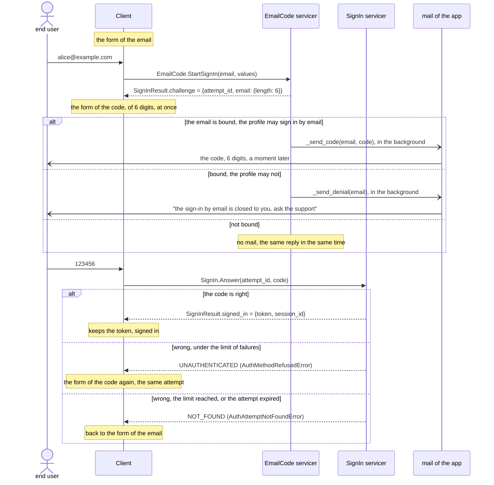
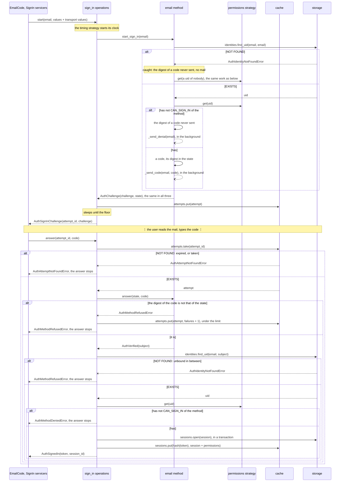

# ingot-auth: the email_code method

A part of [the methods](README.md). An email and a code of `CODE_LENGTH`
digits, 6, sent to it, of two steps: the start sends the code, the answer
repeats it. Its second step is built in, so it takes no
[factor](factors.md). The identifier is the email, normalized to NFKC,
stripped and case-folded, the same as that of the [email](email.md) method.
The server keeps the sha256 digest of the code in the state of the attempt,
never the code: the cache may be read by more than the server. The code is
good for the attempt, as long as it lives and till the answers refused
reach their limit.

The core sends no mail: an application extends `BaseAuthEmailCodeMethod`
with the hook `_send_code(email, code)`, by the mail of its own, and
declares it as the slot of its methods,
`email_code = Slot(AppEmailCodeMethod)`.

`phone_code` is its twin by SMS, to come.

## Stories

### 1. Signing up

| # | Actor | Story | Needs | Status |
|---|---|---|---|---|
| <a id="email-code-1-1"></a>1.1 | end user | **I sign up with my email, by the code sent to it.**<br>• The email is checked by the preset of the policies of the method, its slot `preset_sign_up_email`, empty unless an application binds policies to it in its subclass.<br>• An email taken is told only after its code, at the end, `AuthIdentityConflictError`: who does not own it learns nothing ([methods.4.2](README.md#methods-4-2)).<br>• Example: given alice@example.com free, when she starts, then the reply is a challenge of 6 digits and the mail brings the code; when she answers it, then a profile is created.<br>• Today the code is sent before the reply; in the background with [methods.2.3](README.md#methods-2-3). | [methods.3.1](README.md#methods-3-1) | Implemented |

### 2. Signing in

| # | Actor | Story | Needs | Status |
|---|---|---|---|---|
| <a id="email-code-2-1"></a>2.1 | end user | **I sign in by the code sent to my email.**<br>• The start sends the code only to an email bound to a profile, and asks for it all the same otherwise, no code then good: this step of the method is there, the flow and the service are not.<br>• The method knows the identifier at its start, so it checks the permission there ([methods.4.1](README.md#methods-4-1)). It tells the refusal by its own channel, not to the client: the client gets the same challenge, and the email gets a mail "the sign-in by email is closed to you, ask the support" in place of the code, by a hook next to `_send_code`, `_send_denial` (the user, 2026-11-03). Who owns the email learns it at once; who does not learns nothing.<br>• Example: given alice without `AuthEmailCodePermissions.CAN_SIGN_IN`, when she starts a sign-in by email, then the client shows the form of the code, and her mail says the way is closed; a code typed all the same is refused, `AuthMethodRefusedError`, as none was sent. | [methods.2.3](README.md#methods-2-3), [methods.4.1](README.md#methods-4-1), [methods.4.2](README.md#methods-4-2) | Draft |
| <a id="email-code-2-2"></a>2.2 | end user | **The code did not come: I ask for another, in the same attempt.**<br>• A new code replaces the old one in the state of the attempt; the resends are limited, as the answers are. | [2.1](#email-code-2-1) | Draft |

### 3. Binding

| # | Actor | Story | Needs | Status |
|---|---|---|---|---|
| <a id="email-code-3-1"></a>3.1 | end user | **I add my email to my profile, verified by the code sent to it, and sign in by a code to it, or take that code as my second factor.**<br>• The code of the bind is the verification of the email ([methods.2.5](README.md#methods-2-5)): two steps, `EmailCode.StartBind` then `Bind.Answer`; nothing is stored before the code, and a verified email of another profile is answered as a free one, its owner told by mail.<br>• It opens a way to sign in: by a code sent to the email.<br>• It opens a second factor: the code by mail, for the sign-ins by a password or a provider, once the user turns it on ([factors.1.2](factors.md#factors-1-2)).<br>• With the same bind it opens the sign-in by the email and the password, if the profile has one ([email.3.1](email.md#email-3-1)).<br>• Example: given alice signed up by nickname, when she binds alice@example.com and answers its code, then she may sign in by a code to it, and turn on the code by mail after her password. | [methods.5.1](README.md#methods-5-1), [methods.2.5](README.md#methods-2-5) | Draft |

## Flows

The sign-in as the client sees it, the [TwoStepMethod](README.md#flows) of
the email:



The same on the server. A lookup that finds nothing raises, `--x`, and
stops what runs, but at the start of the method: there it is caught, and the
start answers alike in every case, the digest in the state of the attempt
good for no code when none was sent. The answer finds the profile again, as
it may be gone or switched off in between:



## API

### The method of the application: Implemented

Under the names of today, `BaseAuthEmailMethod` and the slot `email`:

```python
class AppEmailMethod(BaseAuthEmailMethod):
    @t.override
    async def _send_code(self, email: str, code: str) -> None:
        await self.project.mail.send(email, f"Your code: {code}")

class AppMethods(AuthMethods):
    email = Slot(AppEmailMethod)
```

### Sign-up, Python: Implemented

```python
start = AuthStartSignUpParameters(
    method="email", parameters=AuthEmailStart(email="alice@example.com")
)
challenge = await project.operations.runner.run(
    project.auth.sign_up.op_start, start, metadata
)
assert isinstance(challenge, AuthSignUpChallenge)
answer = AuthAnswerSignUpParameters(attempt_id=challenge.attempt_id, answer="123456")
result = await project.operations.runner.run(
    project.auth.sign_up.op_answer, answer, metadata
)
assert isinstance(result, AuthSignedUp)
```

| Field | Of | What |
|---|---|---|
| `method` | `AuthStartSignUpParameters` | `email`, the path of the slot of the method, `email_code` to be. |
| `parameters` | `AuthStartSignUpParameters` | `AuthEmailStart(email)`: the identifier once normalized, checked by `preset_sign_up_email`. |
| `values` | `AuthStartSignUpParameters` | The values of the attributes of the session whose source is the client, by their ids ([sessions.1.1](../sessions.md#sessions-1-1)), kept with the attempt till the end. |
| `attempt_id` | `AuthSignUpChallenge` | The attempt to answer to: 32 random bytes, URL-safe. |
| `challenge` | `AuthSignUpChallenge` | `AuthEmailChallenge(length)`: the code has `length` digits. |
| `attempt_id`, `answer` | `AuthAnswerSignUpParameters` | The attempt, and the code as typed, a string. |
| `uid` | `AuthSignedUp` | The new profile. |

Errors of the start: `AuthMethodNotFoundError`; `AuthItemNotFoundError`,
`AuthItemInvalidError`, a value of an attribute; `AuthMethodInvalidError`, a
policy of the email broken. Of the answer: `AuthAttemptNotFoundError`, none
waits under the id, expired, over, or of another flow;
`AuthMethodRefusedError`, a wrong code, the attempt kept under
`AUTH_ATTEMPT_MAX_FAILURES`; `AuthIdentityConflictError`, the email bound in
between.

### The service, gRPC: Draft

The starts of the method; the answers by the services of the flows,
`SignUp.Answer`, `SignIn.Answer`, `Bind.Answer` ([methods.2.2](README.md#methods-2-2)):

```proto
// ingot_auth/methods/email_code/v1/email_code.proto
service EmailCode {
  rpc StartSignUp(StartRequest) returns (ingot_auth.sign_up.v1.SignUpResult);
  rpc StartSignIn(StartRequest) returns (ingot_auth.sign_in.v1.SignInResult);
  rpc StartBind(StartRequest) returns (ingot_auth.bind.v1.BindResult);
}

message StartRequest {
  string email = 1;
  // the values of the attributes of the session, by their ids
}
```

```python
reply = await email_code.StartSignIn(StartRequest(email="alice@example.com"))
reply = await sign_in.Answer(
    AnswerRequest(attempt_id=reply.challenge.attempt_id, code=code_from_the_user)
)
token = reply.signed_in.token
```
