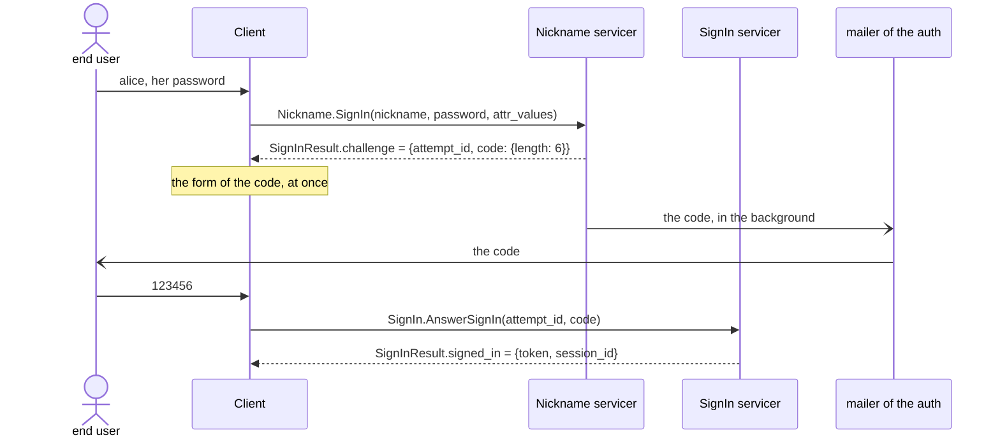

# ingot-auth: the second factors

A part of [the methods](README.md). A factor is a second credential the
flow asks for after a method of one step verified, of the profile, not of
the method: the same factors serve the nickname, the email, a provider. A
method of a code, `email_code`, `phone_code`, has its second step built in
and takes none. Nor is a factor the verification of an identifier, once,
on its sign-up or its bind ([methods.2.5](README.md#methods-2-5)): a factor
proves who signs in, every time.

- **A code by mail**, once the profile has an email bound.
- **A code by SMS**, once it has a phone bound; how secure that is, is
  another talk.
- **A code of an authenticator app**, TOTP, once the user enrolled it.

A factor has the shape of a method of two steps, `start` and `answer`, but
confirms a profile known, by its uid, instead of finding one. The code by
mail and the `email_code` method share the mail of the code, built by
`_build_code_mail`, and the mailer of the auth.

## Stories

| # | Actor | Story | Needs | Status |
|---|---|---|---|---|
| 1.1 | end user | **After my password, the sign-in asks for my second factor, if I turned one on.** • The flow, once the profile is found and may sign in, asks the strategy in the slot `second_factor` of the sign-in whether this profile, by this method, needs a factor and which; the factors are entities in the slot `factors`, `email_code`, `phone_code`, `totp`. • `AuthNoSecondFactor`, none; `AuthProfileSecondFactor`, the factor the user turned on, none for the methods of a code. No default, as every strategy. • The factor starts, the flow keeps an attempt waiting for it, and the client gets a challenge, as from a method of two steps; the answer goes to the factor by the attempt, `SignIn.AnswerSignIn` ([methods.2.2](README.md#methods-2-2)). • Example: given alice with the code by mail on, when she signs in by nickname and password, then the reply is a challenge of 6 digits, the mail brings the code, and her answer opens the session. | [methods.4.1](README.md#methods-4-1) | Draft |
| 1.2 | end user | **I turn on the code by mail, or by SMS, as my second factor, once that email or phone is bound to my profile.** | [1.1](#factors-1-1), [methods.5.1](README.md#methods-5-1) | Draft |
| 1.3 | end user | **I enroll an authenticator app: the secret shown as a QR code, confirmed by its first code.** | [1.1](#factors-1-1), [sessions.2.2](../sessions.md#sessions-2-2) | Draft |

## Flows

A sign-in by nickname with the code by mail as the second factor:

## Questions

1. Parked. Do the sign-up and the bind ask for a
   factor too, the bind of a new email after the password, say? And the
   codes of recovery, when the phone is lost? Holds [1.1](#factors-1-1),
   later.
