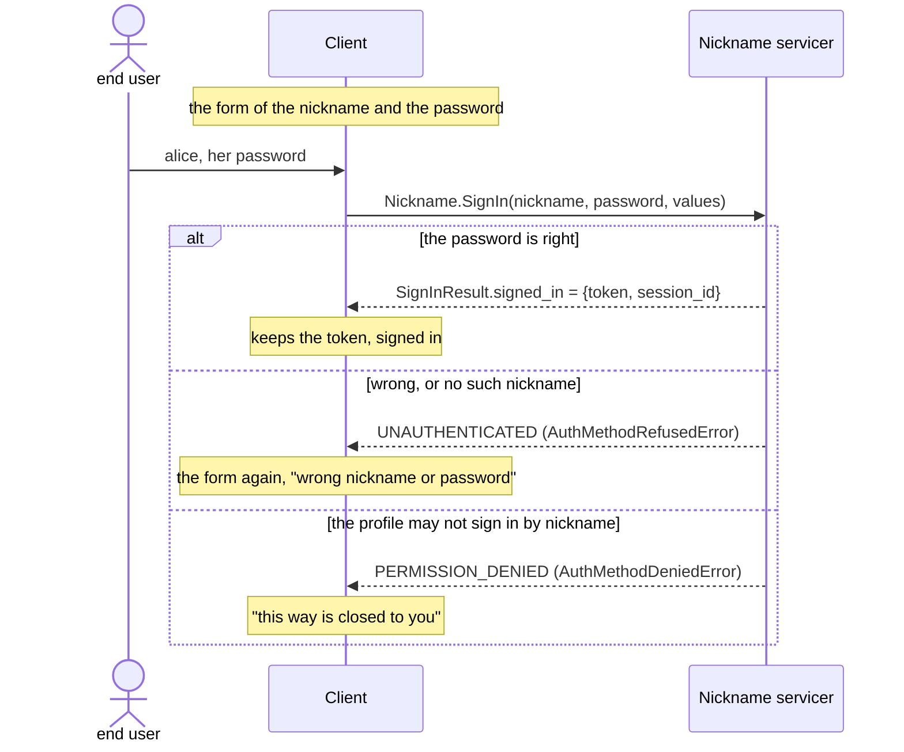

# ingot-auth: the nickname method

A part of [the methods](README.md). A nickname and the
[password](password.md) of the profile, of one step: the identifier is the
nickname, normalized to NFKC and case-folded, so that `Alice` is `alice`.

Today `ingot_auth.contrib.methods.password.AuthPasswordMethod`, the slot
`password`; `nickname` in the core after the move and the rename
([methods.1.1](README.md#methods-1-1)).

## Stories

### 1. Signing up

| # | Actor | Story | Needs | Status |
|---|---|---|---|---|
| <a id="nickname-1-1"></a>1.1 | end user | **I sign up with a nickname and a password, in one step.**<br>• The nickname is checked by the preset of the policies `preset_sign_up_nickname`, the password by that of the password ([password.2.1](password.md#password-2-1)), both empty unless an application binds policies to them in a subclass.<br>• Example: given a policy of a length of 12 bound to the password, when alice signs up with `secret`, then `AuthMethodInvalidError` names the field `password` and the policy.<br>• Example: given alice signed up, when `Alice` signs up, then `AuthIdentityConflictError`: the nickname is taken, and told ([methods.4.2](README.md#methods-4-2)). | [methods.3.1](README.md#methods-3-1), [password.1.1](password.md#password-1-1) | Implemented |

### 2. Signing in

| # | Actor | Story | Needs | Status |
|---|---|---|---|---|
| <a id="nickname-2-1"></a>2.1 | end user | **I sign in with my nickname and my password, in one step, and get the token at once, or the challenge of my second factor.**<br>• The method verifies the password of the profile of the nickname; a nickname bound to none is verified against the hash of nothing all the same, `AuthMethodRefusedError` in both. The step of the method is there, by the secret of the nickname; the flow of the sign-in and the service are not. | [methods.2.2](README.md#methods-2-2), [methods.4.1](README.md#methods-4-1), [password.1.2](password.md#password-1-2) | Draft |

### 3. Binding

| # | Actor | Story | Needs | Status |
|---|---|---|---|---|
| <a id="nickname-3-1"></a>3.1 | end user | **Signed up by my email, a code or a provider, I add a nickname to my profile, and sign in by it with my password.**<br>• A nickname needs no verification, only to be free ([methods.2.5](README.md#methods-2-5)): the bind is of one step, and a nickname taken is told, as on a sign-up, the caller signed in already.<br>• It opens a way to sign in: by the nickname and the password of the profile, once the profile has one ([password.1.3](password.md#password-1-3)).<br>• It opens no second factor: nothing is sent to a nickname.<br>• Example: given alice signed up by `email_code`, with a password set, when she binds `alice`, then she signs in by `alice` and her password as well. | [methods.5.1](README.md#methods-5-1), [password.1.2](password.md#password-1-2) | Draft |

## Flows

The sign-in as the client sees it, the [OneStepMethod](README.md#flows) of
the nickname, with no second factor:



## API

### Sign-up, Python: Implemented

Under the names of today, `password` and `AuthPasswordStart`:

```python
start = AuthStartSignUpParameters(
    method="password",
    parameters=AuthPasswordStart(nickname="alice", password="..."),
    values={device_model_id: "Pixel 9"},  # the id of a client attribute
)
result = await project.operations.runner.run(
    project.auth.sign_up.op_start, start, metadata
)
assert isinstance(result, AuthSignedUp)  # one step: never a challenge
```

| Field | Of | What |
|---|---|---|
| `method` | `AuthStartSignUpParameters` | The name of the method, the path of its slot in the methods: `password`, `nickname` to be. |
| `parameters` | `AuthStartSignUpParameters` | `AuthPasswordStart`, below. |
| `values` | `AuthStartSignUpParameters` | The values of the attributes of the session whose source is the client, by their ids ([sessions.1.1](../sessions.md#sessions-1-1)); kept in the record of the sign-up. |
| `nickname` | `AuthPasswordStart` | The identifier once normalized, NFKC and case-folded; checked by `preset_sign_up_nickname`. |
| `password` | `AuthPasswordStart` | Normalized to NFKC, never in a `repr`; checked by `preset_sign_up_password`, `preset_set` of the password to be ([password.2.1](password.md#password-2-1)), then hashed. |
| `uid` | `AuthSignedUp` | The new profile: 128 random bits, 32 hexadecimal digits. |

Errors: `AuthMethodNotFoundError`, no such method; `AuthItemNotFoundError`,
`AuthItemInvalidError`, a value of an attribute unknown or of another type;
`AuthMethodInvalidError(field, binding)`, a policy broken;
`AuthIdentityConflictError`, the nickname taken; `OperationPermissionsError`,
no `CAN_SIGN_UP`.

### The service, gRPC: Draft

```proto
// ingot_auth/methods/nickname/v1/nickname.proto
service Nickname {
  rpc SignUp(SignUpRequest) returns (ingot_auth.sign_up.v1.SignUpResult);
  rpc SignIn(SignInRequest) returns (ingot_auth.sign_in.v1.SignInResult);
  rpc Bind(BindRequest) returns (ingot_auth.bind.v1.BindResult);
}

message SignUpRequest {
  string nickname = 1;
  string password = 2;
  // the values of the attributes of the session, by their ids
}

message SignInRequest {
  string nickname = 1;
  string password = 2;
  // the values of the attributes of the session, by their ids
}

message BindRequest {
  string nickname = 1;
}
```

```python
reply = await nickname.SignIn(SignInRequest(nickname="alice", password="..."))
if reply.HasField("challenge"):  # her second factor
    reply = await sign_in.Answer(
        AnswerRequest(attempt_id=reply.challenge.attempt_id, code=code_from_the_user)
    )
token = reply.signed_in.token
```

The message of the values of the attributes is to be decided with the slice
that brings the service.
