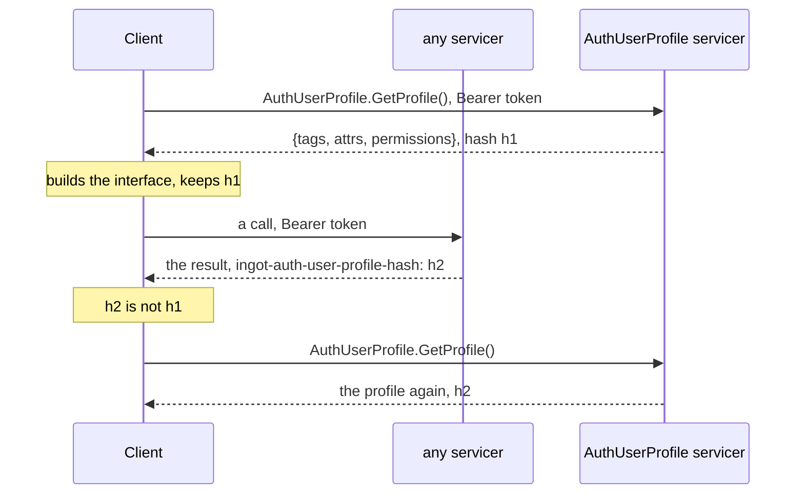

# ingot-auth: the profile

A part of [the design of the auth](README.md). What the auth knows of a
user:

- **The profile itself**: its `uid`, what the rest of an application knows
  the user by, and the time it was created, by the sign-up.
- **Its identifiers**: a nickname, an email, a phone, an id at a provider,
  each `(kind, value)` bound to the uid, verified before it is stored ([methods.2.4](methods/README.md#methods-2-4), [2.5](methods/README.md#methods-2-5));
  **its secrets**: what verifies them, the hash of its one password
  ([password.1.2](methods/password.md#password-1-2)), a TOTP secret.
- **Its tags**: marks it has or has not, `premium`; **its attributes**:
  typed values, a birth date. Each of a registry, ids and names, the
  metadata giving the registries to the consumers.
- **Its permissions**: of [access](access.md), computed, not kept.
- **Its version**, raised by each change of it, and **its history**: what
  was done to it, when, by whom and why.

The client sees a part of it, the tags, the attributes and the permissions,
to build its interface ([1.3](#profile-1-3)); the user takes all of it out,
or has it deleted, by the GDPR.

## Stories

### 1. The profile and its values

| # | Actor | Story | Needs | Status |
|---|---|---|---|---|
| <a id="profile-1-1"></a>1.1 | operator | **I register the tags and the attributes a profile may hold, each attribute with its type, and rename or delete them; the metadata gives them by their ids.**<br>• The services `Tags` and `Attrs` of `ingot_auth.profiles.tags.v1` and `ingot_auth.profiles.attrs.v1`: `Create`, `List`, `Rename`, `Delete`. | — | Implemented |
| <a id="profile-1-2"></a>1.2 | operator | **I set the tags and the values of the attributes of a profile.**<br>• The profile holds only its uid and its time today. | [1.1](#profile-1-1) | Draft |
| <a id="profile-1-3"></a>1.3 | client | **I get my profile, its tags, its attributes and my permissions, to build my interface, and learn when it changed, so that I show no button the server refuses.**<br>• The server is the truth; the profile a client holds is an aid to its interface, as the catalogue of the permissions is.<br>• The permissions are a part of the profile the client sees, as the tags and the attributes are.<br>• `AuthUserProfile.Get` gives the profile of the caller and its hash, computed once, when the profile comes into the cache with the session ([sessions.2.4](sessions.md#sessions-2-4)), and carried by `AuthCaller`.<br>• Every reply carries the hash in the metadata of its transport, under one name for all, `ingot-auth-user-profile-hash` (the user, 2026-11-03): a header in HTTP, a key of the trailing metadata in gRPC. Not an `ETag`: that is of the resource of the reply. Lowercase with hyphens, as gRPC takes no other key and HTTP does not care; no `X-` (RFC 6648). The core gives the hash, each transport puts it where it puts such things.<br>• The client compares it with its own and asks for the profile again when it differs: a permission granted shows on the next reply, and one taken away hides its button before a refusal.<br>• A refusal, `PERMISSION_DENIED` or 403, stays the safety net: the client asks again on it.<br>• Example: given alice granted `CAN_MODIFY_ITEM`, or tagged `premium`, when her client makes any call, then the reply carries a new hash, the client asks for the profile and shows the button.<br>• A push of the change, by a stream, later if ever: only for an interface that must change without any request. | [1.2](#profile-1-2), [sessions.2.2](sessions.md#sessions-2-2), [sessions.2.4](sessions.md#sessions-2-4), [access.1.1](access.md#access-1-1) | Draft |
| <a id="profile-1-4"></a>1.4 | end user | **I change the attributes of my profile the application lets me, my name, my birth date, and see the change on my next request.**<br>• Which attributes a user may write, the registry tells, or a permission of the attribute ([Q2](#profile-q2)).<br>• A value is checked by the type of its attribute, as one of an operator is; the tags stay of the operator. | [1.2](#profile-1-2), [1.3](#profile-1-3) | Draft |
| <a id="profile-1-5"></a>1.5 | operator | **I find a profile by its uid, or by an identifier bound to it, and read it whole: its identifiers, its tags and attributes, its groups, its sessions.**<br>• An identifier by its kind and value, `(email, alice@example.com)`, as a method finds it. | [1.1](#profile-1-1) | Draft |
| <a id="profile-1-6"></a>1.6 | operator | **I create a profile without a sign-up, a user imported, an account of a test, with its identifiers, tags and attributes; the user sets its password later.**<br>• An identifier an operator binds is taken as verified, or confirmed by its user first ([Q3](#profile-q3)). | [1.2](#profile-1-2), [methods.2.4](methods/README.md#methods-2-4) | Draft |
| <a id="profile-1-7"></a>1.7 | operator | **A profile has a version, raised by each change of it, and a change I make names the version I read: one made since by another operator is not overwritten, mine is refused as a conflict.**<br>• Optimistic: no lock; the operator reads the profile again and decides.<br>• The hash of [1.3](#profile-1-3) covers the permissions too, granted by the groups, not by the profile: whether it is built of the version ([Q4](#profile-q4)). | [1.2](#profile-1-2) | Draft |
| <a id="profile-1-8"></a>1.8 | operator | **I name the attributes in a tree, `address/city`, `address/zip`, and a client groups them by it.**<br>• A rule of the names, the registry flat, or a structure read and written by a branch ([Q5](#profile-q5)). | [1.1](#profile-1-1) | Draft |

### 2. The history of a profile

| # | Actor | Story | Needs | Status |
|---|---|---|---|---|
| <a id="profile-2-1"></a>2.1 | operator | **I see the history of a profile: what was done to it, when, by whom and why, a change of an operator with the reason it gave, the number of a task.**<br>• An entry a change: created, blocked, a password set, an identifier bound, a tag or an attribute set, a group joined; its time, its actor, the user itself, an operator by its uid, or the system, what it changed and its reason.<br>• The operator gives the reason with the call ([Q6](#profile-q6)); an application may require one.<br>• Written in the transaction of the change, so that no change goes without its entry.<br>• Not the events of [sessions.3.7](sessions.md#sessions-3-7): those are for the others to react to, the history for the operator to read. | [1.2](#profile-1-2) | Draft |

### 3. The data of a user, by the GDPR

| # | Actor | Story | Needs | Status |
|---|---|---|---|---|
| <a id="profile-3-1"></a>3.1 | end user | **I take out all the auth keeps of me, in a file I can take elsewhere.**<br>• The profile, its identifiers, tags and attributes, the sessions with their attributes, the record of the sign-up, the history; no secret, not even its hash.<br>• Articles 15 and 20 of the GDPR. | [1.3](#profile-1-3), [2.1](#profile-2-1) | Draft |
| <a id="profile-3-2"></a>3.2 | end user | **I suspend my profile: it signs in no more, its sessions close, and after a grace period it is deleted, unless I come back.**<br>• How a user comes back within the grace period ([Q7](#profile-q7)). | [3.3](#profile-3-3), [sign-out.1.4](sign-out.md#sign-out-1-4) | Draft |
| <a id="profile-3-3"></a>3.3 | operator | **I delete a profile, by the request of its user or by the law: its data go, its identifiers are free again.**<br>• What of the history stays, and how long, the law tells ([Q8](#profile-q8)).<br>• Article 17 of the GDPR. | [2.1](#profile-2-1) | Draft |
| <a id="profile-3-4"></a>3.4 | application | **I set how long the closed sessions, the records of the sign-ups and the history are kept; the sweep deletes those older.**<br>• The retention [the threats of the sessions](sessions.md#threats) wait for. | [sessions.3.4](sessions.md#sessions-3-4) | Draft |

## Flows

The profile of the caller, and its change seen on any reply:



## API sketch

```proto
// The package and the path by ADRs 0009 and 0011, the RPCs by 0013, to be
// named with the slice that brings it.
service AuthUserProfile {
  rpc GetProfile(GetProfileRequest) returns (GetProfileResponse);
}

message GetProfileResponse {
  repeated uint32 tag_ids = 1;   // the ids of the registry of the tags
  // the values of the attributes, by their ids
  map<string, int32> permissions = 3;  // a mask per domain
  string hash = 4;
}
```

```python
profile = await user_profile.GetProfile(GetProfileRequest(), metadata=auth)
reply, call = await shop.Buy.with_call(request, metadata=auth)
if dict(call.trailing_metadata())["ingot-auth-user-profile-hash"] != profile.hash:
    profile = await user_profile.GetProfile(GetProfileRequest(), metadata=auth)
```

## Questions

1. <a id="profile-q1"></a>Parked. The name of the service, `AuthUserProfile`
   as said, or by the packages of the contracts, `ingot_auth.profiles.v1`,
   `Profile`? And the message of the values of the attributes, shared with
   those of a session. Hold [1.3](#profile-1-3), of slice 4.
2. <a id="profile-q2"></a>Parked. Which attributes a user may write: a mark
   of the attribute in its registry, as a session attribute has its source,
   or a permission an attribute? Holds [1.4](#profile-1-4).
3. <a id="profile-q3"></a>Parked. An identifier an operator binds: verified
   as given, or confirmed by a code to its user first? Holds
   [1.6](#profile-1-6).
4. <a id="profile-q4"></a>Parked. The hash of the profile a client sees and
   the version: the hash of the version and the permissions, or each apart?
   Holds [1.7](#profile-1-7); [1.3](#profile-1-3) goes without it.
5. <a id="profile-q5"></a>Parked. The tree of the attributes: a rule of the
   names, `/` between the parts, the registry and the metadata flat, a
   client building the tree; or a structure the operations take by a
   branch? Holds [1.8](#profile-1-8).
6. <a id="profile-q6"></a>Parked. The reason of an operator: a field of the
   request of each change, or the metadata of the call, under one name for
   all, as the hash of the profile goes? Holds [2.1](#profile-2-1).
7. <a id="profile-q7"></a>Parked. A user back within the grace period: a
   sign-in restores the profile, asks first by a challenge, or the operator
   alone restores it? Holds [3.2](#profile-3-2).
8. <a id="profile-q8"></a>Parked. What stays of a profile deleted: its
   history without the data of the user, its uid kept so that no new
   profile takes it? Holds [3.3](#profile-3-3).
