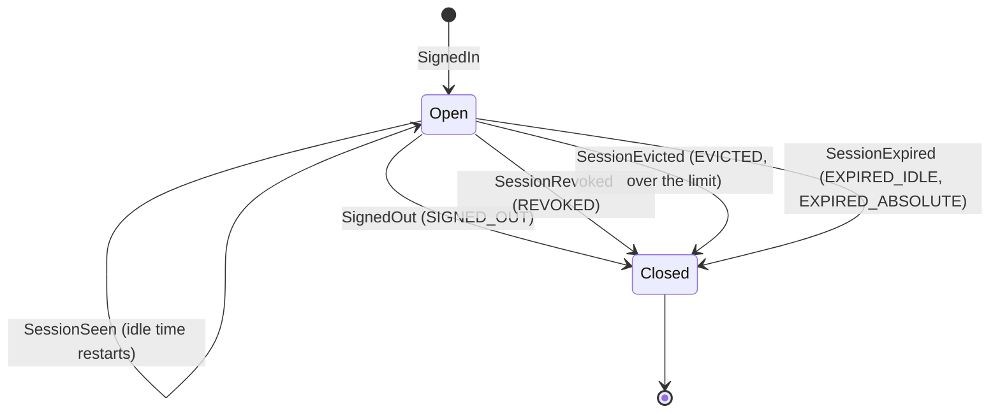
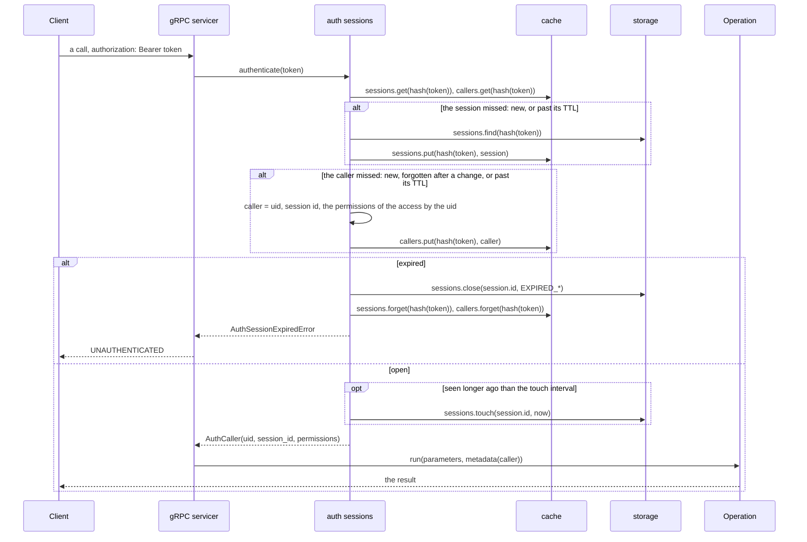

# ingot-auth: the sessions

A part of [the design of the auth](README.md). A sign-in proves who the user
is once; the session it opens stands for the proof after it. The client
keeps the token of the session and sends it with each call, the server
turns it into a caller, till the session ends: by time, by the limit, by a
sign-out ([sign-out](sign-out.md)). The session stays kept, closed, as the
record of the sign-in: when, by what method, from where.

What a session happened on is in its attributes, a registry of the
subdomain of the session: each a typed value with its source, who gives it
and so how far it is trusted:

- `transport`: from the call itself, the IP; a client never gives it;
- `client`: what the client says, its device, its version, not a fact;
- `provider`: of the method of the sign-in, once its token is checked;
- `derived`: the server derives it from the others, the country by the IP.

The presets of the sessions group the attributes a client gives, each bound
to its attributes as required or not, many to many.

## Domain

A session is open until it closes, for one of five reasons:



## Stories

### 1. A session and its token

| # | Actor | Story | Needs | Status |
|---|---|---|---|---|
| <a id="sessions-1-1"></a>1.1 | application | **I register the attributes a session keeps, each with its type and its source, and the presets a client gives them by; the client learns them from the metadata and gives their values with a sign-up.**<br>• An attribute keeps its type and its source once given: renaming keeps them, nothing changes them.<br>• The metadata gives a client the attributes whose source is the client, and the presets with their bindings; the others are not for it.<br>• A sign-up checks the values the client gives: an attribute unknown or not the client's, `AuthItemNotFoundError`; a value of another type, `AuthItemInvalidError`. They are kept in the record of the sign-up, as no session opens then.<br>• The values kept with a session come with it ([1.2](#sessions-1-2)). | — | Implemented |
| <a id="sessions-1-2"></a>1.2 | client | **A sign-in gives me a token, once, that I send with each call.**<br>• The token is random, 256 bits, given once at the sign-in; the server keeps its hash, never the token: sha256, the token being random, a slow hash buying nothing (the user, 2026-11-05: "а там посмотрим").<br>• The session has an id of its own, public, shown in the list of the sessions ([3.2](#sessions-3-2)); the id never authenticates.<br>• The session keeps the values of its attributes, those of the client checked as on a sign-up ([1.1](#sessions-1-1)). | [1.1](#sessions-1-1), [methods.4.1](methods/README.md#methods-4-1) | Implemented |
| <a id="sessions-1-3"></a>1.3 | transport | **I give the attributes of the transport, the IP, and the client cannot give them.**<br>• The values of the client are checked by the source of the attributes; the transport ones come from the servicer only ([Q1](#sessions-q1)). | [1.2](#sessions-1-2), [methods.2.2](methods/README.md#methods-2-2) | Draft |

### 2. Working in a session

The token on every request, turned into a caller.

| # | Actor | Story | Needs | Status |
|---|---|---|---|---|
| <a id="sessions-2-1"></a>2.1 | client | **I send the token with each call, and an expired or revoked one gives one error I can tell from the others, so I ask to sign in again.**<br>• Example: given a session expired, a call gets `UNAUTHENTICATED`, whatever the reason the session closed for; the reason of the error tells more, `SESSION_EXPIRED` with why it closed, `SESSION_NOT_FOUND` for a token of no open session. | [2.2](#sessions-2-2) | Implemented |
| <a id="sessions-2-2"></a>2.2 | transport | **I turn the token of a request into a caller, or into the anonymous one with no token, in one call.**<br>• `authenticate(token)` finds the session by the hash of the token, in the cache, or in the storage on a miss; asks the strategy of the lifetime ([3.1](#sessions-3-1)) whether it expired, and closes it if so; gives its caller, `AuthCaller` with the uid, the id of the session and the permissions, from the cache, or formed by the access on a miss ([access.1.1](access.md#access-1-1)).<br>• A final method of `AuthSessions`, not an operation (the user, 2026-11-05): the simple first, an operation, with its logs and its run uid, can come later if a caller not yet one needs them.<br>• The caller has the uid of the profile and the permissions of the strategy of the access (the user, 2026-11-05); the session holds none, it stays a session (the user, 2026-11-08); how the operations of the sessions learn the session, an `AuthCaller(Caller)` with `session_id` or the token in their parameters, is the choice of the pull request that builds it: `AuthCaller(Caller)` with `session_id`.<br>• Over gRPC the token comes as `authorization: Bearer <token>`, read by `_get_caller()` of the servicers; the other ways a call bears a credential, a cookie of gRPC-Web, mTLS, a key of an API, wait for a strategy in a slot, an application overriding the hook till then (the user, 2026-11-11). | [1.2](#sessions-1-2), [3.1](#sessions-3-1), [access.1.1](access.md#access-1-1) | Implemented |
| <a id="sessions-2-3"></a>2.3 | operation | **I read the uid of the caller from the metadata, and nothing else of the auth.**<br>• `metadata.caller.uid`, of the `Caller` of ingots. | [2.2](#sessions-2-2) | Implemented |
| <a id="sessions-2-4"></a>2.4 | end user | **A change of my profile, a permission granted, a tag, shows on my next request, without signing in again.**<br>• The permissions are of the caller, formed after the sign-in and on a miss, and kept in the cache next to the session, by the same hash, apart from it, with the rest of the profile the client sees, its tags and its attributes ([profile.1.3](profile.md#profile-1-3)), never in the token nor in the storage: a request that hits the cache reads nothing more (the user, 2026-11-03, 2026-11-08).<br>• A change of any of them forgets the callers of the profile in the cache, by the hashes of its open sessions, after the storage commits, the sessions kept: the next request misses the caller and forms it again, signed in still. A change that must end the sessions, a block, a stolen account, revokes them instead ([sign-out.1.3](sign-out.md#sign-out-1-3), [sign-out.1.4](sign-out.md#sign-out-1-4)): no token, nothing to take from the cache.<br>• Example: given alice signed in on two devices, when she is granted a permission, then both see it on their next request, neither signs in again; when her sign-in by nickname is switched off, her sessions stay, as they are signed in already, unless the operator revokes them.<br>• The entries of the cache live a TTL, `AUTH_SESSION_CACHE_TTL`, a bound on a change that went past the operations, by hand in the database, or a process stopped between the commit and the forgetting.<br>• A cache of the memory is of one process: who runs more needs a shared one, Redis.<br>• Built so far: the permissions, forgotten on a change of the memberships ([access.2.5](access.md#access-2-5)), by `forget_callers(uid)` of the sessions, the open ones found by `get_open(uid)` of their storage; the tags and the attributes come into the caller with [profile.1.3](profile.md#profile-1-3). | [2.2](#sessions-2-2), [access.1.1](access.md#access-1-1) | Implemented |

### 3. Managing the sessions

How long they live, how many, who sees them, what is kept of them.

| # | Actor | Story | Needs | Status |
|---|---|---|---|---|
| <a id="sessions-3-1"></a>3.1 | application | **I set one of the strategies of the lifetime of the sessions the auth has, sliding, fixed, or both, or one of my own.**<br>• The strategy is an entity in the slot `lifetime` of the sessions: given a session and the time, it tells whether the session expired and why, and whether its time seen is to be written. The core has three:<br>&nbsp;&nbsp;◦ `AuthSlidingLifetime`: expires idle longer than its TTL (`EXPIRED_IDLE`);<br>&nbsp;&nbsp;◦ `AuthFixedLifetime`: expires open longer than its TTL (`EXPIRED_ABSOLUTE`);<br>&nbsp;&nbsp;◦ `AuthSlidingFixedLifetime`: both, whichever comes first.<br>• The TTLs are configs, tuned per environment: `AUTH_SESSION_IDLE_TTL` of the sliding strategies, `AUTH_SESSION_TTL` of the fixed ones; the strategy of both reads both. A strategy names the configs it reads in its docstring.<br>• The slot has no default: the base is abstract, so mypy flags the slot left unfilled, and the project fails to create.<br>• A sliding strategy writes the time a session was seen at most once per `AUTH_SESSION_TOUCH_INTERVAL`, not on every request; a fixed one never ([Q2](#sessions-q2)).<br>• Example: given the sliding one of 30 days, a client used daily stays signed in forever; given the fixed one of a day, the user signs in daily.<br>• Example: given a session idle too long, when its token comes, then the session closes with `EXPIRED_IDLE` and the request is refused.<br>• Example: an application of its own: a session of an operator, by a tag of the profile, lives an hour, the others a month.<br>• Built so far: `AuthFixedLifetime`, by `AUTH_SESSION_TTL`; the sliding ones come with slice 3. | [1.2](#sessions-1-2) | Draft |
| <a id="sessions-3-2"></a>3.2 | end user | **I see my sessions, the device, the place and the time each was last seen, and which one is this one.**<br>• The list gives the public id of each session, never its token, and marks the one of the caller by the id in its `AuthCaller`. | [2.2](#sessions-2-2) | Draft |
| <a id="sessions-3-3"></a>3.3 | application | **I set one of the strategies of the limit of the sessions of a profile the auth has, or one of my own.**<br>• Over `AUTH_SESSIONS_MAX` open sessions of a profile, what a sign-in does is the strategy in the slot `limit` of the sessions:<br>&nbsp;&nbsp;◦ `AuthEvictOldestLimit`: signs out the one seen the longest ago (`EVICTED`);<br>&nbsp;&nbsp;◦ `AuthRefuseLimit`: refuses the sign-in;<br>&nbsp;&nbsp;◦ `AuthNoLimit`: none.<br>• No default, as every strategy: a starter picks one, the evicting one for the web, so that a user who lost a device is not locked out. | [1.2](#sessions-1-2) | Draft |
| <a id="sessions-3-4"></a>3.4 | operator | **I sweep the expired sessions, so that they are closed with their reason without waiting for a request.** | [3.1](#sessions-3-1) | Draft |
| <a id="sessions-3-5"></a>3.5 | operator | **I see when and from where a profile signed in, the sessions closed included.**<br>• A session is kept after it closes, with its values, times, reason and who closed it: the record of the sign-in. | [1.2](#sessions-1-2) | Draft |
| <a id="sessions-3-6"></a>3.6 | another service | **It checks a token of a user by the auth, without its own sessions.** | [2.2](#sessions-2-2) | Draft |
| <a id="sessions-3-7"></a>3.7 | application | **Events of the sign-in and the sessions, for the analytics and the audit.** | [1.2](#sessions-1-2) | Draft |

## Flows

A session has two keys. The hash of its token is the key of the way in: a
request brings the token, so the cache keys by its hash alone, and the
storage finds by it once, on a miss. The id is the key of the record: the
storage writes by it, and the user and the operator name a session by it,
as they never see a token. Closing by the id, the storage gives back the
hash, for the cache to forget it ([sign-out](sign-out.md#flows)).

An authenticated request; a miss of the cache goes to the storage, and a
session found expired closes there:



## API sketch

The code each actor writes. Not run yet: the prototype comes once the
stories are taken.

The application (stories [3.1](#sessions-3-1), [3.3](#sessions-3-3)): the
strategies of the sessions and their configs, in a subclass of the sessions;
the permissions are of the caller, by [the access](access.md#api-sketch):

```python
class AppConfigs(AuthConfigs):
    AUTH_SESSION_IDLE_TTL = IntConfig(30 * DAY)
    AUTH_SESSIONS_MAX = IntConfig(10)

class AppSessions(AuthSessions):  # the subdomain: its registries and the sessions
    lifetime = Slot(AuthSlidingLifetime)
    limit = Slot(AuthEvictOldestLimit)

class AppAuth(AuthUnit):
    sessions = Slot(AppSessions)
```

The operation (story [2.3](#sessions-2-3)): nothing new, the uid is that of
the caller:

```python
class Buy(BaseOperation[BuyParameters, Receipt]):
    PERMISSIONS = Permissions(ShopPermissions.CAN_BUY)

    @t.override
    async def _run(self, parameters: BuyParameters, metadata: OperationMetadata) -> Receipt:
        uid = metadata.caller.uid
        ...
```

The transport (stories [1.3](#sessions-1-3), [2.2](#sessions-2-2)): the gRPC
contrib does it, an application's servicer inherits it; `_get_caller`
becomes asynchronous:

```python
class BaseAuthGrpcServicer(GrpcServicer):
    async def _get_caller(self, context: Context) -> Caller:
        token = get_bearer_token(context.invocation_metadata())
        if token is None:
            return self._get_anonymous_caller()
        return await self.project.auth.sessions.authenticate(token)
```

The client (stories [2.1](#sessions-2-1), [3.2](#sessions-3-2)):

```python
auth = [("authorization", f"Bearer {token}")]
await shop.Buy(request, metadata=auth)
# an expired token: grpc.StatusCode.UNAUTHENTICATED, sign in again
mine = await sessions.ListOwn(Empty(), metadata=auth)  # each with is_current
```

What the core gives, by package (ADR 0007):

- `ingot_auth/sessions/lifetimes.py`: `BaseAuthSessionLifetime`,
  final `check(session, now)` over the hooks `_expire()` and `_touch()`, and
  the three strategies; `limits.py` alike.
- `ingot_auth/sessions/`, the package `session/` renamed (the user,
  2026-11-05): `AuthSessions`, the unit of the subdomain, its registries
  `attrs` and `presets` as slots, with `authenticate()`,
  `op_list_own`, the revokes ([sign-out](sign-out.md#api-sketch)),
  `cmd_*`; `AuthSessionRecord` (id, uid, method, token hash, attr_values,
  opened, seen, closed, reason, closed by); the caller of a
  session, its form the pull request's (2.2); the errors `AuthSessionNotFoundError`,
  `AuthSessionExpiredError`.
- The storage `storage.sessions` and the cache `cache.sessions`, by
  business operations: `open`, `find`, `touch`, `close`, `close_all`,
  `list_open`, `list_expired`; `get`, `put`, `forget`. Their contracts under
  `testing/contracts`, the memory backends first.

What is checked where: mypy checks the strategies and the slots of the
sessions; the class creation checks each slot is a subclass of its base; the
run checks the token, the expiry and the permissions.

## Threats

| Category | Threat | Answer |
|---|---|---|
| Spoofing | Session fixation: a token set by an attacker. | The token is made by the server at the sign-in, never taken from the client. |
| Spoofing | A stolen token. | Kept hashed by the server; idle and absolute limits; the user and the operator revoke; TLS by the transport. |
| Tampering | A client gives the IP, a transport attribute. | The values of the client are checked by the source of the attributes; the transport ones come from the servicer only. |
| Tampering | A token forged. | 256 random bits, nothing inside to forge, no signature to break. |
| Repudiation | "I did not sign in from there." | A session is kept after it closes, with its values, times, reason and who closed it. |
| Information disclosure | A token in the logs, the cache, a dump. | `repr=False`, never logged; the cache and the storage key by the hash; no pickle. |
| Information disclosure | The sessions of another user. | `list_own` lists those of the caller; the others need `CAN_LIST_ANY`. |
| Denial of service | Sessions piling up. | `AUTH_SESSIONS_MAX`, the sweep; a retention of the closed ones later, with the GDPR. |
| Denial of service | The storage hit on every request. | The cache; the touch written once per interval. |
| Elevation of privilege | Permissions stale in a caller. | Of the caller, kept next to the session in the cache only, forgotten there by every change, after its commit, and bounded by the TTL of the cache; never in the token nor the storage. |

## Alternatives

- **JWT as the token.** Stateless, but a revocation needs a list of revoked
  tokens anyway, and the permissions inside go stale. No.
- **The session id as the token.** The id is shown in the list of the
  sessions; the token must never be. Two values.
- **Pickled sessions in Redis keyed by the token** (words). Pickle trusts the
  cache; the key leaks the token. A dataclass of plain values keyed by the hash.
- **Redis expiry events to close the sessions.** Not delivered for sure;
  the storage is the truth, closed lazily and by the sweep.
- **A pair of tokens, access and refresh.** Useful with stateless tokens;
  with a session looked up on every request one token is enough. Later, if
  story [3.6](#sessions-3-6) needs it.

## Questions

1. <a id="sessions-q1"></a>Parked. Where the transport values (the IP) go: a
   field of the parameters of the start the client cannot reach (the
   servicer sets it), or the metadata? Holds [1.3](#sessions-1-3), of slice
   3.
2. <a id="sessions-q2"></a>Parked. The idle limit is then precise to the
   touch interval. Fine? Holds [3.1](#sessions-3-1) sliding, of slice 3.
