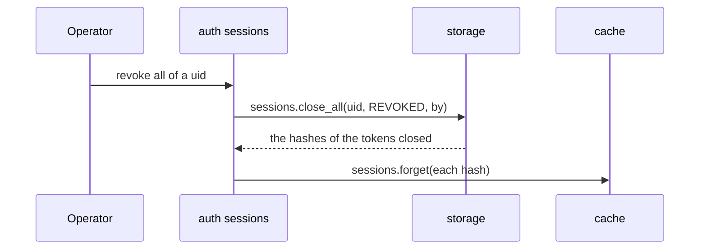

# ingot-auth: the sign-out

A part of [the design of the auth](README.md). A session ended by a person,
its user or an operator:

- the user signs out this session, or one of the others, a lost phone, or
  all of them but this one: `SIGNED_OUT`, `REVOKED`;
- the operator signs out every session of a profile, a stolen account:
  `REVOKED`;
- the operator blocks a profile: it signs in no more, its sessions close.

A session ends by itself too, by time or over the limit, `EXPIRED_*`,
`EVICTED`: those are of [the sessions](sessions.md#3-managing-the-sessions).

## Stories

| # | Actor | Story | Needs | Status |
|---|---|---|---|---|
| <a id="sign-out-1-1"></a>1.1 | end user | **I sign out, and the token works no more, from the very next request.**<br>• Closing a session forgets it in the cache after the storage commits: the next request misses the cache and finds it closed.<br>• Signing out with a closed, expired or unknown token succeeds: there is nothing to tell an attacker, and a client may retry. | [sessions.2.2](sessions.md#sessions-2-2) | Draft |
| <a id="sign-out-1-2"></a>1.2 | end user | **I sign out one session, a lost phone, or all of them but this one.**<br>• By the public id of a session of the caller's own; another's is not found. | [sessions.3.2](sessions.md#sessions-3-2) | Draft |
| <a id="sign-out-1-3"></a>1.3 | operator | **I sign out every session of a profile, a stolen account.** | [sessions.1.2](sessions.md#sessions-1-2) | Draft |
| <a id="sign-out-1-4"></a>1.4 | operator | **I block a profile: it signs in no more, its sessions close.**<br>• A profile is blocked when it has the sign-in of no method; blocking takes them off and closes its sessions ([Q1](#sign-out-q1)). | [1.3](#sign-out-1-3), [access.1.2](access.md#access-1-2) | Draft |

## Flows

Revoking: the storage first, the cache after it, so that a failure between
them leaves a closed session in the cache for its TTL at most:



## API sketch

The end user through the client (stories [1.1](#sign-out-1-1),
[1.2](#sign-out-1-2)):

```python
await sessions.SignOut(Empty(), metadata=auth)
await sessions.RevokeOwn(RevokeOwnRequest(session_id=lost.id), metadata=auth)
await sessions.RevokeOthers(Empty(), metadata=auth)
```

The operator (stories [1.3](#sign-out-1-3), [1.4](#sign-out-1-4),
[sessions.3.4](sessions.md#sessions-3-4)), by the CLI of the project:

```
app auth sessions revoke-all <uid>
app auth profiles block <uid>
app auth sessions sweep
```

In the core, operations of `AuthSessions` ([sessions](sessions.md#api-sketch)):
`op_sign_out`, `op_revoke_own`, `op_revoke_others`, `op_revoke_all`.

## Threats

| Category | Threat | Answer |
|---|---|---|
| Elevation of privilege | A blocked profile keeps its sessions. | Blocking closes them; the sign-in checks `CAN_SIGN_IN` of the method. |
| Elevation of privilege | A user revokes the sessions of another. | `revoke_own` takes an id of the caller's sessions only; any other needs `CAN_REVOKE_ANY`. |

## Questions

1. <a id="sign-out-q1"></a>Parked. A block of a profile: the sign-in of no
   method, or a block of its own, global, telling "banned", not "no
   permission"? The user leans to the global one too: a permission missing
   tells "you may not by this method", not "you are banned", and unblocking
   would give back what there was. Holds [1.4](#sign-out-1-4), later.
