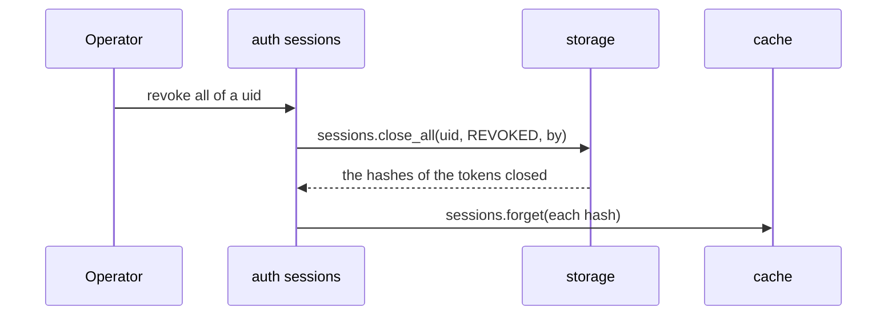

# ingot-auth: the sign-out

A part of [the design of the auth](README.md). A session ended by a person,
its user or an operator:

- the user signs out this session, or one of the others, a lost phone, or
  all of them but this one: `SIGNED_OUT`, `REVOKED`;
- the operator signs out every session of a profile, a stolen account:
  `REVOKED`;
- the operator blocks a profile: it signs in no more, its sessions close.

A session ends by itself too, by time or over the limit, `EXPIRED_*`,
`EVICTED`: those are of [the sessions](sessions.md#3-managing-the-sessions).

## Stories

| # | Actor | Story | Needs | Status | Coverage |
|---|---|---|---|---|---|
| <a id="sign-out-1-1"></a>1.1 | end user | **I sign out, and the token works no more, from the very next request.**<br>• Closing a session forgets it in the cache after the storage commits: the next request misses the cache and finds it closed.<br>• Signing out with a closed, expired or unknown token succeeds: there is nothing to tell an attacker, and a client may retry.<br>• Any caller may: `op_sign_out` of the unit `auth.sign_out` requires no permission, a caller of no session, the anonymous one of a token closed, signing out of nothing (the user, 2026-11-15); over gRPC, `SignOut.SignOut` of `ingot_auth.sign_out.v1`, run for the caller of the token.<br>• The session closes `SIGNED_OUT`; who closed it, `closed_by`, comes with the record ([sessions.3.5](sessions.md#sessions-3-5)).<br>• Over gRPC the token of the call gives the caller; one closed, expired or unknown gives the anonymous one, which signs out of nothing, where another servicer refuses it. | [sessions.2.2](sessions.md#sessions-2-2) | Implemented | `test_sign_out` |
| <a id="sign-out-1-2"></a>1.2 | end user | **I sign out one session, a lost phone, or all of them but this one.**<br>• By the public id of a session of the caller's own; another's is not found.<br>• `RevokeOwnSession(session_id)` and `RevokeOtherSessions`, which tells how many it closed, of the service `Sessions` of `ingot_auth.sessions.v1`; the flag `CAN_REVOKE_OWN` of `auth.sessions`, granted by `auth.grp_signed_in` (the user, 2026-11-15), which an application takes off by its class in the slot, a kiosk. A session revoked closes `REVOKED`, by the caller.<br>• An own session not found, of another, closed or unknown, is `AuthOwnSessionNotFoundError`, `NOT_FOUND` over gRPC, `OWN_SESSION_NOT_FOUND`: the caller stays signed in, where a token not found is `UNAUTHENTICATED`. | [sessions.3.2](sessions.md#sessions-3-2) | Implemented | `test_sessions` |
| <a id="sign-out-1-3"></a>1.3 | operator | **I sign out every session of a profile, a stolen account.**<br>• `auth.sessions.op_revoke_all`, `AuthRevokeAllSessionsParameters(profile_uid=...)`, closing every open session of the profile `REVOKED`, giving how many: each in a transaction of its own, as `op_revoke_others`, with a record `revoke` in the activity log, its caller the operator, then the cache forgets the session and its caller; one closed meanwhile is skipped, not counted.<br>• The flag `CAN_REVOKE` of `auth.sessions`, a bit of its own, granted by `auth.sessions.grp_admins`.<br>• On the command line `auth sessions revoke-all <profile_uid>`, as the root, and over gRPC `RevokeSessions(profile_uid)` of the service `Sessions`, for an admin UI ([Q2](#sign-out-q2)), telling how many.<br>• An unknown profile, or one with no open session, closes none and succeeds: 0.<br>• Example: given alice signed in on a phone and a laptop, when the operator revokes all of hers, then both tokens are refused from the next request, the log tells two `revoke` by the operator, and she signs in anew. | [sessions.1.2](sessions.md#sessions-1-2) | Implemented | `test_operator` |
| <a id="sign-out-1-4"></a>1.4 | operator | **I block a profile: it signs in no more, its sessions close.**<br>• A profile is blocked when it has the sign-in of no method; blocking takes them off and closes its sessions ([Q1](#sign-out-q1)). | [1.3](#sign-out-1-3), [access.1.2](access.md#access-1-2) | Draft | — |

## Flows

Revoking: the storage first, the cache after it, so that a failure between
them leaves a closed session in the cache for its TTL at most:



## API sketch

The end user through the client (stories [1.1](#sign-out-1-1),
[1.2](#sign-out-1-2)):

```python
await sign_out.SignOut(SignOutRequest(), metadata=auth)
await sessions.RevokeOwnSession(RevokeOwnSessionRequest(session_id=lost.id), metadata=auth)
await sessions.RevokeOtherSessions(RevokeOtherSessionsRequest(), metadata=auth)
```

The prototype [own](own/) runs it in the code of the operations, with the
own sessions and the profile of the caller.

The operator (stories [1.3](#sign-out-1-3), [1.4](#sign-out-1-4),
[sessions.3.4](sessions.md#sessions-3-4)), by the CLI of the project:

```
app auth sessions revoke-all <profile_uid>
app auth profiles block <profile_uid>
app auth sessions sweep
```

and an admin UI over gRPC, `RevokeSessions(profile_uid)` and
`SweepSessions()` of the service `Sessions`. The prototype [sweep](sweep/)
runs the revoke and the sweep in the code of their operations.

In the core, the sign-out is a package of its own, `ingot_auth/sign_out/`,
as the sign-in is, likely with one operation, `op_sign_out` (the user,
2026-11-05). The revokes are operations of `AuthSessions`
([sessions](sessions.md#api-sketch)): `op_revoke_own`, `op_revoke_others`,
`op_revoke_all`.

## Threats

| Category | Threat | Answer |
|---|---|---|
| Elevation of privilege | A blocked profile keeps its sessions. | Blocking closes them; the sign-in checks `CAN_SIGN_IN` of the method. |
| Elevation of privilege | A user revokes the sessions of another. | `revoke_own` takes an id of the caller's sessions only; any other needs `CAN_REVOKE_ANY`. |

## Questions

1. <a id="sign-out-q1"></a>Parked. A block of a profile: the sign-in of no
   method, or a block of its own, global, telling "banned", not "no
   permission"? The user leans to the global one too: a permission missing
   tells "you may not by this method", not "you are banned", and unblocking
   would give back what there was. Holds [1.4](#sign-out-1-4), later.
2. <a id="sign-out-q2"></a>Answered: both, the command line and gRPC (the
   user, 2026-11-15: "админка не за горами").
