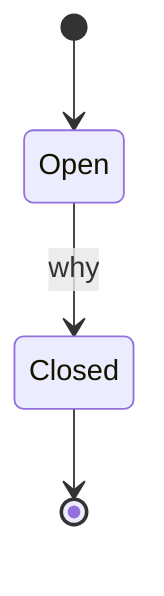
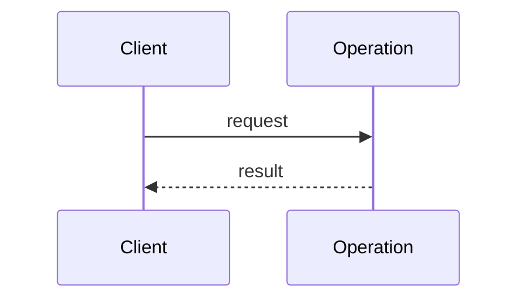

# Short name of the feature

- Status: Draft | Proposed | Accepted | Built | Abandoned
- Packages: the repositories it touches
- Date: YYYY-MM-DD
- ADRs: the records it follows or calls for

A design comes before the code of a feature, as [ADR 0012](../adr/0012-design-a-feature-before-building-it.md)
says. Fill the sections that apply and drop the rest; keep it short, a long
analysis goes to a file of its own next to this one. The design is done when
every story taken has the code of its consumer, and the prototype checks it.

## Problem

What is missing or wrong, for whom, and why now. One paragraph.

## Actors

Who uses what this builds: the author of an application, the author of an
addon or a contrib, the developer of a client, an operator, the end user
whose story drives a flow.

## Domain

What happens in the domain, as events in the past tense, and what states a
thing goes through. Find them first: the units, the flows and the names come
out of them.

- Events: `SignedUp`, `SessionOpened`, ...
- Commands and who gives them: ...



## Stories

As an actor, I want something, so that some outcome. Each story taken is
accepted by the code its actor writes, in the API sketch below; the stories
left for later say what the API must not shut out.

| # | Actor | Story | Now or later |
|---|---|---|---|
| 1 | author of an application | ... | now |

## Rules and examples

A rule of the domain, its examples, and the questions they raise.

- Rule: ...
  - Example: given ..., when ..., then ...
  - Question: ...

## Flows

A flow of more than one step, or across the client, the operations, the
cache and the storage, as a sequence.



## API sketch

The code each actor writes for each story taken, as short as it can be: if
it is long, the API is wrong. The same code goes into the prototype, under
`<topic>/<concept>/`, with a `check_types.py` that runs what can be run and
lines marked `# error:` where mypy must refuse;
`make check-prototype P=docs/design/<topic>/<concept>` runs it, and
`make check-prototypes` all of them, in CI. A concept per directory when there
are options to compare.

```python
class AppSomething(AuthSomething):
    ...
```

What is checked where: by mypy, at the creation of a class, at run time.

## Threats

What an attacker or a mistake could do, by the categories of STRIDE, and
what the design does against it.

| Category | Threat | Answer |
|---|---|---|
| Spoofing | ... | ... |
| Tampering | ... | ... |
| Repudiation | ... | ... |
| Information disclosure | ... | ... |
| Denial of service | ... | ... |
| Elevation of privilege | ... | ... |

## Pre-mortem

Six months on, the design has failed: why? The likely reasons, and what in
the design answers each.

## Alternatives

What else was considered, and why not. Kept so that it is not proposed again
blindly.

## Open questions

## Slices

The implementation, a pull request a slice, each with its first consumer: a
thin path through every layer first, then the rest.

1. ...
